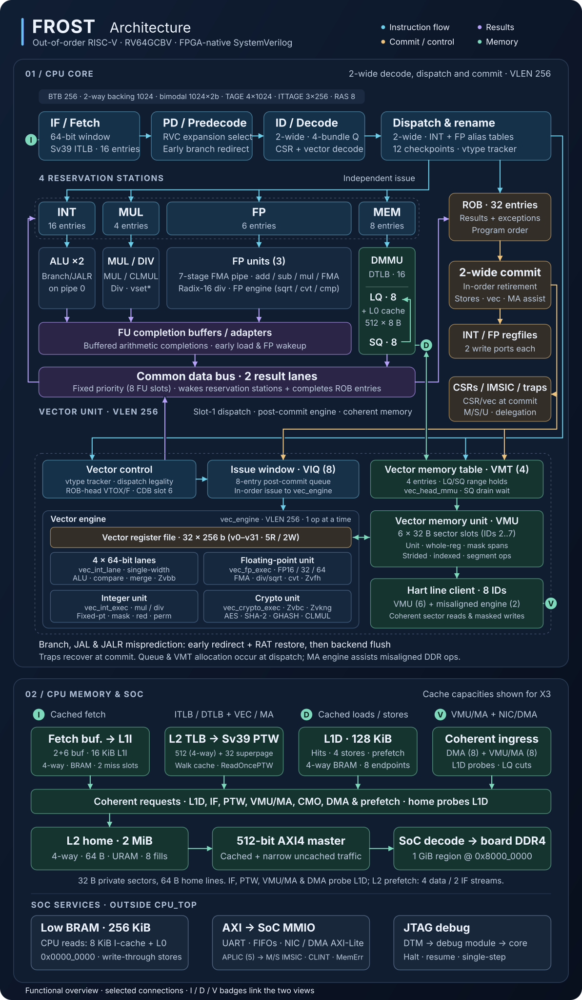

# FROST

**F**PGA **R**ISC-V **O**pen-sourced in **S**ystemVerilog by **T**woSigma

FROST is a two-wide, out-of-order RISC-V processor for FPGAs, written in
SystemVerilog. It implements RV64GCBV with machine, supervisor, and user modes
and Sv39 virtual memory. The AMD Alveo X3522PV configuration targets 322 MHz
and boots Debian 13 with Debian's unmodified riscv64 kernel, mounting its root
filesystem over NFS through its own 10 Gigabit Ethernet NIC. It runs
[CoreMark](sw/apps/coremark/README.md) at 4.89 CoreMark/MHz.

[](docs/diagrams/frost-architecture.svg)

The diagram shows the X3 configuration; click it for the full-size version.

## Highlights

- Debian 13 with systemd on an NFS root filesystem; the
  [Debian guide](docs/debian_nfsroot.md) walks through the setup. A Linux
  driver for the memory error unit reports DDR ECC errors, scrubs corrected
  lines, and patrols memory in the background.
- A 10 Gigabit Ethernet NIC with FROST's own MAC and PCS, descriptor-ring DMA
  that is coherent with the data caches, and a Linux driver. It supports
  scatter-gather transmit, checksum offload, TCP segmentation, configurable
  receive buffering, 802.3x flow control, and packet and error counters.
- Continuous testing on pull requests and pushes to `main`: the RISC-V
  architecture tests and random riscv-torture programs checked against Spike,
  the riscv-tests suites, and TestRIG, which compares FROST with the Sail
  RISC-V model one instruction at a time on random sequences drawn anew on
  every run. CI also runs generated `riscv-vector-tests` programs on the RTL
  simulator at VLEN 128, 256, and 512, TestRIG vector traces against Sail at
  all three vector lengths, and vector bring-up programs on Spike and RTL.
  Formal proofs, unit benches for the hardware blocks, and whole
  programs from BRAM and DDR run alongside, and CI merges simulation coverage,
  including cover points for microarchitectural corner cases, into one report.
- A reusable CPU: `cpu_top` packages the core, its MMUs, and the caches as one
  single-clock module with an AXI4 memory master. In the SoC, the NIC and the
  DMA test engine attach over AXI4: their DMA bursts enter the coherent data
  caches through a bridge, and their registers sit on AXI4-Lite.
- An open-source flow: simulation (Verilator and cocotb), synthesis checks
  (Yosys), and formal proofs (SymbiYosys) run in a pinned Docker image, and
  OpenROAD takes the design from synthesis to GDS on the FreePDK45 process,
  with SRAM macros that OpenRAM generates for the caches, the instruction and
  data memories, and the NIC's buffers; the [ASIC guide](asic/README.md) lists
  what the flow reduces or mocks. AMD Vivado is needed only for the FPGA
  itself: building bitstreams and programming and loading the board.
- A cycle-approximate [performance model](perf-modeling/README.md) of the CPU
  and memory system for design-space sweeps, with RTL event capture and a
  CoreMark IPC comparison against the RTL. Architectural HPM counters 3-10
  report retired branches, mispredictions, L1 instruction and data TLB misses,
  L1D permission misses, store-queue capacity stalls, cycles, and retired
  instructions, plus alternate events on counters 3-8 for L1I refills, L2
  demand and prefetch misses, page-walker busy cycles, and TLB flushes, through
  Linux `perf` and the OpenSBI PMU mapping, with
  Sscofpmf overflow interrupts for `perf record` sampling and per-privilege
  filtering. Optional custom profiling counters report
  stall causes, occupancy, and cache traffic.
- FreeRTOS and all nine EEMBC CoreMark-PRO workloads.
- A [VS Code extension](tools/vscode-frost/README.md) that programs the FPGA,
  builds and loads software, and debugs it with source breakpoints and a
  two-way serial console, locally or over Remote-SSH.
- Native SystemVerilog rather than RTL generated from Chisel or SpinalHDL,
  with optional Xilinx primitives and board integration kept separate.
- The Apache 2.0 license.

## Quick Start

You don't need an FPGA to try FROST. On an x86-64 Linux host with Git, Docker,
and Python 3.12 or newer:

```bash
git clone --recurse-submodules https://github.com/twosigma/frost.git
cd frost
docker build -t frost .                   # build the toolchain image
./scripts/frost.py doctor                 # check the setup (read-only)
./scripts/frost.py cocotb hello_world     # simulate the SoC running Hello World
```

The first image build compiles GCC, Verilator, Yosys, QEMU, Spike, and other
tools from source, so expect it to take a while; `doctor` reports when a
change to the Dockerfile calls for a rebuild. The last command compiles the
program, simulates the full SoC in Verilator, and prints `Frost: Hello, world!`
from the simulated UART. `scripts/frost.py` runs each tool inside the image as
your user, so build outputs stay yours. Use it for every simulation, formal,
and lint run.

Other programs to simulate:

```bash
./scripts/frost.py cocotb directed_traps      # directed M-mode trap and interrupt tests
./scripts/frost.py cocotb isa_test            # ISA self-test
./scripts/frost.py cocotb coremark            # CoreMark benchmark
./scripts/frost.py cocotb coremark_pro_core   # CoreMark-PRO core workload
./scripts/frost.py cocotb freertos_demo       # FreeRTOS demo
./scripts/frost.py cocotb ddr_heap_test       # multi-MB malloc through the caches into DDR
./scripts/frost.py cocotb frost_cache         # cache hierarchy unit bench
./scripts/frost.py cocotb --list-tests        # every simulation target

# Run a program from cached DDR instead of on-chip BRAM
FROST_COCOTB_MEM_CONFIG=ddr ./scripts/frost.py cocotb hello_world

# Write waveforms (tests/dump.fst)
WAVES=1 ./scripts/frost.py cocotb directed_traps

# Open a shell inside the image
./scripts/frost.py shell
```

## Try it without an FPGA

A standalone C++ Verilator runner simulates the `frost` SystemVerilog RTL with
live UART output and no Python in the clock loop. On every CI run, `test-native`
compares live unseeded cocotb runs of BRAM and DDR `hello_world` and BRAM
CoreMark with the native runner on cycles, CoreMark ticks, and UART bytes
alongside each program's pass, CRC, and summary conditions; the full comparison
mode (`tests/test_native_sim.py --all`) adds DDR CoreMark and checkpoint save
and restore against live unseeded cocotb runs:

```bash
./scripts/frost.py native hello_world
./scripts/frost.py native coremark --threads 4
./scripts/frost.py native coremark --mem-config ddr --threads 4
```

With the `frost` development image built first (`docker build -t frost .`, see
[Quick Start](#quick-start)) and the CoreMark submodule initialized,
`demo/Dockerfile` packages baseline x86-64 simulator binaries (`1`, `4`, and `8`
threads) and prebuilt programs into a small standalone runtime container
(`frost-demo:local`), which CI builds and runs in `test-demo-image`:

```bash
git submodule update --init --recursive sw/apps/coremark/coremark
docker build -f demo/Dockerfile -t frost-demo:local .
docker run --rm -it -e COLORTERM frost-demo:local
```

The container runs for about five minutes on four cores. A
[ray tracer](sw/apps/raytrace) draws its picture (a glossy red sphere and a
glossy blue sphere on a tiled floor under a sunset) in the terminal row by row as
the simulated CPU computes it, while a status line shows the rows done, the
time left, and the core at work (instructions per cycle, branch predictions
that hit, reorder-buffer entries in use, cycles that retire two instructions).
One CoreMark iteration follows, reported as passed and in how many cycles,
then a table of what the core did in each program, counted over the ray
tracer's rendering and CoreMark's timed loop. Both
programs check their own results. A computer too slow to draw the full picture
in about six minutes gets the small one and says so (`--full` keeps the full
one). `--quick` runs the small picture; `--raw` and `--app`
print the unfiltered UART output of `hello_world` and CoreMark;
`--help` lists the rest.

The picture is drawn in 24-bit color when the terminal advertises it and in the
256-color palette (nearest color, no dithering) otherwise. `frost-show` decides
only from these, in order: `--truecolor` or `--256`; `NO_COLOR` (plain text);
the `COLORTERM` variable (`truecolor` or `24bit`); a `TERM` that names direct
color; else 256 colors, with one line under the picture saying how to get full
color. It never queries the terminal. `-e COLORTERM` (no value) forwards your
shell's variable, which modern terminals set; `-e COLORTERM=truecolor` states
it outright; `--truecolor` or `--256` forces either mode (`docker run` sets
`TERM=xterm` inside the container unless you pass `-e TERM`). `NO_COLOR`
set, a `TERM` that is not a known cursor-addressable type, or output that is
not a terminal gives plain text with no cursor or color codes. Known types are
xterm and its relatives, screen, tmux, rxvt, vt100 and later, linux, alacritty,
kitty, foot, wezterm, ghostty, konsole, gnome, st and iterm; anything else
(`tty33`, `dumb`, `unknown`, unset) gets plain lines. On a terminal narrower than
the picture (77 columns for the full one) the picture is scaled down by a
whole factor, and below 39 columns it is not drawn.

Every clock cycle evaluates the hardware model in software; RTL simulation is
far slower than hardware. See [hw/sim/native/README.md](hw/sim/native/README.md)
for what runs, how it compares with the cocotb flow, what the summary figures
mean, and how to run other applications.

## Running on the FPGA

FPGA builds and board tools run natively on a host with Vivado 2025.2 and the
[RISC-V toolchain](docs/tooling.md#shared-risc-v-toolchain):

```bash
# 1. Build the bitstream (takes hours)
./fpga/build/build.py x3

# 2. Program the FPGA
./fpga/program_bitstream/program_bitstream.py x3

# 3. Load software; this doesn't touch the bitstream
./fpga/load_software/load_software.py x3 hello_world
./fpga/load_software/load_software.py x3 coremark
./fpga/load_software/load_software.py x3 isa_test

# CoreMark-PRO: -v1 validates results, -v0 measures performance
./fpga/load_software/load_software.py x3 coremark_pro_core -v1
./fpga/load_software/load_software.py x3 coremark_pro_radix2 -v1
```

The UART console runs at 115200 baud, 8N1; the VS Code extension has a
built-in serial terminal. The [FPGA guide](fpga/README.md) covers target
selection, debugging, and the hardware regression, and the
[Debian guide](docs/debian_nfsroot.md) covers booting Linux.

## Architecture

### Supported RISC-V Extensions

FROST implements RV64GCBV (G = IMAFD, Zicsr, and Zifencei). The table lists
every supported extension and privilege mode.

| Extension        | Description                                    |
|------------------|------------------------------------------------|
| **RV64I**        | Base 64-bit integer instruction set |
| **M**            | Integer multiply/divide                        |
| **A**            | Atomic memory operations (LR/SC, AMO; word and doubleword) |
| **F**            | Single-precision floating-point (32-bit)       |
| **D**            | Double-precision floating-point (64-bit)       |
| **Zfhmin**       | Half-precision loads, stores, moves and conversions to and from single and double precision |
| **Zfa**          | Additional floating-point instructions: `fli`, `fminm`/`fmaxm`, `fround`/`froundnx`, `fcvtmod.w.d`, `fleq`/`fltq` |
| **C**            | Compressed instructions (16-bit encodings) |
| **Zcb**          | Compressed byte/halfword loads and stores, `c.zext.*`, `c.sext.*`, `c.not`, `c.mul`, expanded at instruction fill |
| **Zcmop**        | Compressed may-be-operations `c.mop.n`, which write no register |
| **B**            | Bit manipulation (B = Zba + Zbb + Zbs)         |
| **V**            | Vector extension, VLEN 256: integer, fixed-point, floating-point, mask and permutation instructions and every vector load and store form |
| **Zicsr**        | CSR access instructions                        |
| **Zicntr**       | Base counters (cycle, time, instret)           |
| **Zihpm**        | Performance counters `hpmcounter3`-`10`, gated by `mcounteren`/`scounteren` |
| **Zifencei**     | Instruction fence                              |
| **Zicond**       | Conditional zero                               |
| **Zbkb**         | Bit manipulation for crypto                    |
| **Zbc**          | Carry-less multiplication (clmul, clmulh, clmulr) |
| **Zbkc**         | Carry-less multiplication for crypto (clmul, clmulh) |
| **Zihintpause**  | Pause hint for spin-wait loops                 |
| **Zihintntl**    | Non-temporal locality hints (`ntl.*`, `c.ntl.*`), retired as no-ops |
| **Zimop**        | May-be-operations `mop.r.n`/`mop.rr.n`, which write zero to rd |
| **Zawrs**        | `wrs.nto`/`wrs.sto` retire at once; `wrs.nto` traps below M with `mstatus.TW` set |
| **Zicboz**       | Cache-block zero (`cbo.zero`, 64-byte blocks of cached DDR and low BRAM) |
| **Zicbom**       | Cache-block management (`cbo.clean`, `cbo.flush`, `cbo.inval` on 64-byte blocks): clean and flush write a dirty L1D or L2 line to DDR before they complete, flush and inval remove every cached copy, inval discards dirty data (or flushes with `CBO_INVAL_AS_FLUSH`), through cacheable, NC and IO mappings alike; the device tree lists it with `riscv,cbom-block-size = <64>` |
| **Zicbop**       | Cache-block prefetch hints (`prefetch.i/r/w`), executed as no-ops |
| **Machine Mode** | M-mode privilege (mret, wfi, ecall, ebreak)    |
| **Supervisor Mode** | S-mode privilege, trap delegation, Sv39 virtual memory, Sstc timers |
| **Smaia, Ssaia** | AIA CSRs and machine/supervisor IMSIC files with 63 identities |
| **Sscofpmf**     | HPM counter overflow (OF, `scountovf`, local counter-overflow interrupt 13) and MINH/SINH/UINH privilege filtering on counters 3..10 |
| **Ssnpm**        | Pointer masking for U-mode (`senvcfg.PMM`, PMLEN 7 and 16): explicit scalar U-mode accesses, including AMOs, LR/SC and CBOs, ignore the top PMLEN address bits (sign-extended under Sv39, zero-extended under Bare). Vector memory execution applies the same transform to each element address. |
| **Supm**         | Scalar U-mode pointer masking supplied by Ssnpm when the execution environment enables it; the supplied Linux image does not expose the tagged-address ABI |
| **Sstvala**      | An illegal-instruction exception writes the faulting instruction's bits to `mtval` or `stval`, a compressed instruction's 16 bits zero-extended; an instruction or data access, misaligned or page fault, a failed bus response included, writes the faulting virtual address |
| **Ssu64xl**      | UXLEN is 64: `mstatus.UXL` and `sstatus.UXL` read 2 and cannot change |
| **Svade**        | Software-managed accessed and dirty bits: an access that needs one set raises a page fault |
| **Svinval**      | Fine-grained address-translation cache invalidation (`sinval.vma`, `sfence.w.inval`, `sfence.inval.ir`) |
| **Svnapot**      | 64 KiB NAPOT leaf PTEs (N = 1, PPN[3:0] = 1000 at level 0): each page translates with PPN[3:0] = VA[15:12] and fills the TLBs as a 4 KiB entry; every other N encoding is a page fault |
| **Svpbmt**       | PTE bits 62:61 under `menvcfg.PBMTE`: NC and IO loads use the uncached path at the ROB head; DDR mappings require a configured alias into the coherent DMA port. The VCU118's 2 GiB map has no alias, so NC/IO DDR mappings raise access faults and the VCU118 device tree omits `svpbmt`; device mappings are unaffected. AMO/LR/SC, `cbo.zero` and fetch on NC or IO pages are access faults |
| **Svvptc**       | A PTE changed from invalid to valid becomes visible to the walker without `sfence.vma` |
| **Zic64b, Ziccif, Ziccrse, Ziccamoa, Zicclsm, Za64rs, Zkt, Ssccptr, Sstvecd, Sscounterenw** | RVA22 profile properties: 64-byte cache blocks, instruction fetch, LR/SC, AMOs and misaligned loads and stores in cached memory (performed in hardware by default on the X3 and VCU118), reservation sets of at most 64 bytes, data-independent latency for the Zkt instructions, page-table walks of cached memory, direct-mode `stvec`, and a writable `scounteren` bit for each counter that is not read-only zero |
| **User Mode**    | U-mode privilege and system calls |

### Microarchitecture

- Tomasulo out-of-order execution with two-wide decode, rename, and commit, a
  32-entry reorder buffer, and precise exceptions.
- Four reservation stations, two integer ALUs, and an integer multiply/divide
  unit with carry-less multiplication. Full-width multiplies take eight
  cycles to a dependent use. The radix-4 divider takes up to 35 cycles,
  or 19 for W forms. A load result can wake dependent integer and memory
  operations a cycle before the common data bus broadcasts it.
- Single- and double-precision floating point on three units. A seven-stage
  pipeline runs add, subtract, multiply, and fused multiply-add and accepts
  one operation per cycle. It wakes dependents a cycle before the result
  reaches the final register, so they can read the operand from that register.
  For normal operands, a radix-16 divider takes 12 cycles in single precision
  and 19 in double precision. An engine handles square root and conversions,
  with dedicated two-cycle paths for compares, moves, min/max, FCLASS, and
  sign injection. Integer-to-FP conversion takes four cycles, or two for zero.
- Branch prediction with a 256-entry BTB, a 1024-entry two-way backing BTB
  whose jump, call and return predictions redirect fetch from predecode, a
  bimodal and a tagged path-history direction predictor, and an 8-entry
  return stack. A mispredicted conditional branch or JALR redirects fetch and
  restores the rename tables the cycle after it resolves, and a mispredicted
  JAL launches early recovery once older branches and JALRs resolve.
- Sv39 virtual memory with hardware page-table walks, separate 16-entry
  instruction and data TLBs backed by a 512-entry second-level TLB and a
  32-entry superpage array, and nine-bit ASIDs with global pages and
  selective `sfence.vma`. Intra-page instruction translation uses the
  live page offset without a fetch bubble. Eligible loads and stores can
  bypass the lookup stage on a hit in any data TLB entry.
- Separate instruction and data paths into a cache hierarchy. On X3: 16 KiB
  L1I, 128 KiB L1D, and 2 MiB L2, all four-way, and a 512-entry L0 cache in the
  load queue. The L1D holds 32-byte sectors in I, S or M states, with eight
  read slots and up to eight requests in flight to the L2, seven of them for
  load misses. A read-hit pipeline serves eligible loads while the controller
  handles misses or stores. Four ordered store records install Modified-sector
  hits with masked writes and give waiting reads turns between stores.
  The L2's coherence home orders the L1s, page-table walks and DMA by sector
  and has eight fills with data and instruction stream prefetching. The build
  connects one hart. Low BRAM uses an 8 KiB instruction cache and L0 data
  reads with write-through stores.
  DMA is coherent with the data caches; fills marked non-allocating use
  L2 way 0, while hits can use any way.
- 256 KiB of on-chip BRAM and 1 GiB of cached DDR4, with the same
  [memory map](sw/README.md#memory-map) in simulation and on hardware.
- UART, CLINT-compatible timer, an APLIC interrupt controller that delivers
  interrupts directly or as MSIs to the CPU's IMSIC files, a memory error
  unit, and 10GBASE-R Ethernet.
- JTAG debugging with halt, resume, and single-step through OpenOCD and GDB.

The [design documentation](#design-documentation) below explains how each
part works.

## Supported FPGA Boards

| Board | FPGA | Ethernet | Cache hierarchy → main memory |
|---|---|---|---|
| Alveo X3522PV | UltraScale+ (xcux35) | 10GBASE-R | 128 KiB L1D + 16 KiB L1I → 2 MiB URAM L2 → 1 GiB DDR4 |
| VCU118 Evaluation Board | Virtex UltraScale+ (xcvu9p) | 1 Gb/s RJ-45 and 10GBASE-R on QSFP1 lane 0 | 128 KiB L1D + 32 KiB L1I → 4 MiB URAM L2 → 2 GiB DDR4 |

See the [board guide](boards/README.md) for pinouts, clocking, and adding a board.

<!-- FPGA_UTILIZATION_START -->

### FPGA Resource Utilization

**Alveo X3522PV** (UltraScale+ xcux35; post-synthesis report)

| Resource | Used | Available | Util% |
|----------|-----:|----------:|------:|
| CLB LUTs | 405,631 | 1,029,600 | 39.4% |
|   LUT as Logic | 373,451 | 1,029,600 | 36.3% |
|   LUT as Distributed RAM | 30,562 | - | - |
|   LUT as Shift Register | 1,618 | - | - |
| CLB Registers | 225,950 | 2,059,200 | 11.0% |
| Block RAM Tile | 288 | 2,112 | 13.6% |
| URAM | 66 | 352 | 18.8% |
| DSPs | 87 | 1,320 | 6.6% |
| CARRY8 | 5,604 | 128,700 | 4.3% |
| F7 Muxes | 2,095 | 514,800 | 0.4% |
| F8 Muxes | 961 | 257,400 | 0.4% |
| Bonded IOB | 132 | 364 | 36.3% |
| MMCM | 1 | 11 | 9.1% |
| PLL | 3 | 22 | 13.6% |

<!-- FPGA_UTILIZATION_END -->

## Development

### Tests and Checks

```bash
./scripts/frost.py check                     # CI's lint and fast Python test jobs
./scripts/frost.py pytest                    # the cocotb targets registered for pytest
./scripts/frost.py cocotb directed_traps     # a single target
./scripts/frost.py formal                    # formal proofs
./scripts/frost.py synthesis                 # open-source synthesis checks (Yosys)
./asic/orfs.py run                           # OpenROAD flow from synthesis to GDS
```

The lint hooks in `check` can modify files, so review the diff afterwards.
Use `./scripts/frost.py lint` for lint alone, or add `--fail-fast` to `check`
to stop at the first failing phase.

CI runs on pushes to `main`. A pull request starts no CI by itself: adding the
`run-ci` label runs the CI workflow on it, and `run-asic` runs the OpenROAD
flow's synthesis and floorplanning. The full run covers the RISC-V
architecture tests and riscv-torture programs against Spike reference
results, the riscv-tests suites, generated vector programs at three
vector lengths, TestRIG's comparison of each instruction with the Sail
RISC-V model, unit benches for the CPU and SoC
blocks, full programs from on-chip BRAM and from cached DDR, formal proofs,
strict SystemVerilog elaboration and synthesis checks, the Ethernet MAC/PCS
benches, and QEMU boots of the Linux images, and it merges the coverage of the
simulations that contribute most to it, cover points included, into one report. The OpenROAD flow runs in
its own workflow, so a newer push to `main` does not cancel it.
The [test guide](tests/README.md#ci-integration) has the details and the commands
for each suite.

In the CI workflow's **Run workflow** menu, enable `toggle_coverage` to run
only the Cocotb coverage shards with Verilator toggles, the shared image
build, and the Coverage Report. The input defaults to off and takes
precedence over the vector and proof inputs. The whole-SoC coverage shards
allow 40 minutes for startup sweeps within their job limits. The two full
OpenSBI smoke boots collect line and branch coverage in regular CI only.
Collecting toggles makes simulations take several times as long and produces
much larger coverage artifacts. The manual run's job limits allow for the
extra simulation and artifact handling time. See the
[coverage guide](tests/README.md#coverage).

Every started main push checks a vector program for each instruction form,
and pull requests labeled `run-ci` and regular manual runs check a slice.
A manual vector run can replay a chosen slice or run the complete campaign,
as described in the [test guide](tests/README.md#generated-vector-programs-in-ci).

### Building Software

Simulation, FPGA loading, and bitstream builds compile applications
automatically. To compile by hand:

```bash
./scripts/frost.py run make -C sw/apps/hello_world         # one application
./scripts/frost.py run python3 sw/apps/build_all_apps.py   # every standalone application
```

For native builds outside the container, initialize the submodules first with
`git submodule update --init --recursive`.

## Repository Layout

| Directory | Contents |
|-----------|----------|
| [hw/rtl/](hw/rtl/README.md) | CPU, caches, peripherals, and reusable hardware blocks |
| [hw/sim/native/](hw/sim/native/README.md) | Standalone C++ Verilator runner for the SoC RTL |
| [demo/](demo/Dockerfile) | Runtime Docker image: the ray tracer and CoreMark on the RTL, presented by `frost-show`, and `hello_world` and CoreMark unfiltered |
| [sw/](sw/README.md) | Bare-metal libraries, applications, and benchmarks |
| [linux/](linux/README.md) | Linux boot images, firmware, and NIC driver |
| [fpga/](fpga/README.md) | FPGA build, programming, and software-loading tools |
| [boards/](boards/README.md) | Board wrappers and pin constraints |
| [tests/](tests/README.md) | Test runners |
| [verif/](verif/README.md) | Cocotb tests, reference models, and monitors |
| [formal/](formal/README.md) | Formal verification |
| [perf-modeling/](perf-modeling/README.md) | Cycle-approximate performance model of the CPU and SoC, with RTL event capture and a CoreMark IPC check |
| [asic/](asic/README.md) | OpenROAD flow on FreePDK45 and its OpenRAM SRAM macros |
| [tools/vscode-frost/](tools/vscode-frost/README.md) | VS Code extension |
| [docs/](docs/) | Debian setup and toolchain guides; diagrams |
| [scripts/](scripts/) | Docker wrapper and development tools |

### Design Documentation

| Document | Covers |
|----------|--------|
| [RTL overview](hw/rtl/README.md) | SoC structure, memory map, and the data bus rules |
| [CPU integration boundary](hw/rtl/cpu_top/README.md) | Standalone CPU AXI, PMA, reset, debug and coherent ingress contract |
| [SoC wrapper](hw/rtl/soc_top/README.md) | MMIO decode, peripherals, and the AXI4 DMA and AXI4-Lite register paths |
| [CPU](hw/rtl/cpu_and_mem/cpu/README.md) | Front end, branch prediction, address translation, and debug |
| [Out-of-order back end](hw/rtl/cpu_and_mem/cpu/tomasulo/README.md) | Renaming, scheduling, memory ordering, and commit, with a README for each block |
| [Cache hierarchy](hw/rtl/lib/cache/README.md) | Caches, coherence, and the DMA port |
| [NIC](hw/rtl/peripherals/nic/README.md) and [MAC/PCS](hw/rtl/net10g/README.md) | 10 Gigabit Ethernet |

## Toolchain

The Docker image pins the tools CI uses. Vivado is installed separately on the
host, and the ASIC flow runs in OpenROAD-flow-scripts' own image, which
[asic/orfs.py](asic/README.md#the-orfs-image) pins.
[docs/tooling.md](docs/tooling.md) covers native toolchain setup and updating
the image.

| Category | Tool | Version |
|----------|------|---------|
| **Image** | Ubuntu | 26.04 |
| **Runtime** | Python | 3.14.9 (native scripts support 3.12+) |
| | Node.js / npm | 26.12.1 / 12.2.1 |
| **Compiler** | Native GCC / G++ | 16.2.0 |
| | Clang / clang-tidy / clang-format | 23.1.4 |
| | RISC-V GCC for bare metal, OpenSBI and Linux (Bootlin musl) | 16.2.0 (2026.08-1 bleeding-edge) |
| | pip / setuptools / wheel | 26.2.2 / 84.2.1 / 0.48.0 |
| **Build** | CMake / Meson / Ninja | 4.4.4 / 1.12.1 / 1.13.2 |
| | Buildroot / OpenSBI | 2026.08.1 / 1.9 |
| | Debian Linux kernel | 6.12.113-1 (`6.12.113+deb13-riscv64`) |
| **Testbench** | Cocotb / pytest / pytest-cov | 2.1.0 / 9.1.1 / 7.1.0 |
| **Simulator** | Verilator / QEMU | 5.054 / 11.1.2 |
| | Spike | `02b1dc182164bb73b19b050676dd89f0834f8b2e` |
| | Sail RISC-V model / QuickCheckVEngine | 0.16 / `5e15965a819ca1be9f14d2e8e319e98fd89a557f` |
| | riscv-vector-tests (built with Go) | `f76bff121dce91b6b23e1d37be77a5e44af914c3` (Go 1.24.4, build stage only) |
| **Synthesis** | Yosys / sv2v | 0.70 / 0.0.13 |
| **Formal** | SymbiYosys / Z3 / Boolector | 0.70 / 5.3.2 / 3.2.4 |
| **Debug** | OpenOCD | 0.12.0 (Ubuntu package) |
| **FPGA** | Vivado (native, separately installed and validated) | 2025.2 |
| **ASIC** | OpenROAD-flow-scripts (its own image) | 26Q4 |
| **Linting** | pre-commit / Ruff / mypy | 4.7.0 / 0.17.2 / 2.4.0 |
| | Verible | 0.0-4296-g0f262651 |
| **CLI** | Click | 8.5.0 |
| **Extension** | TypeScript / vsce | 7.0.2 / 4.0.0 |

## Status and Roadmap

FROST supports one hart on the Alveo X3522PV and VCU118 evaluation boards.
Both provide coherent Ethernet DMA and the JTAG/OpenSBI boot path for Debian
with an NFS root. The VCU118 has RJ-45 and QSFP1 Ethernet interfaces and can
start OpenSBI and an interactive U-Boot console from SPI flash. See the
[VCU118 guide](boards/vcu118/README.md) for its boot paths and
[ROADMAP.md](ROADMAP.md) for project work.

## Contributors and License

[CONTRIBUTORS.md](CONTRIBUTORS.md) lists contributors. FROST is licensed under
the [Apache License 2.0](LICENSE). The Linux drivers are dual-licensed under
GPL-2.0-only or BSD-2-Clause. The U-Boot drivers use GPL-2.0-or-later,
and third-party code in submodules keeps its own license.
