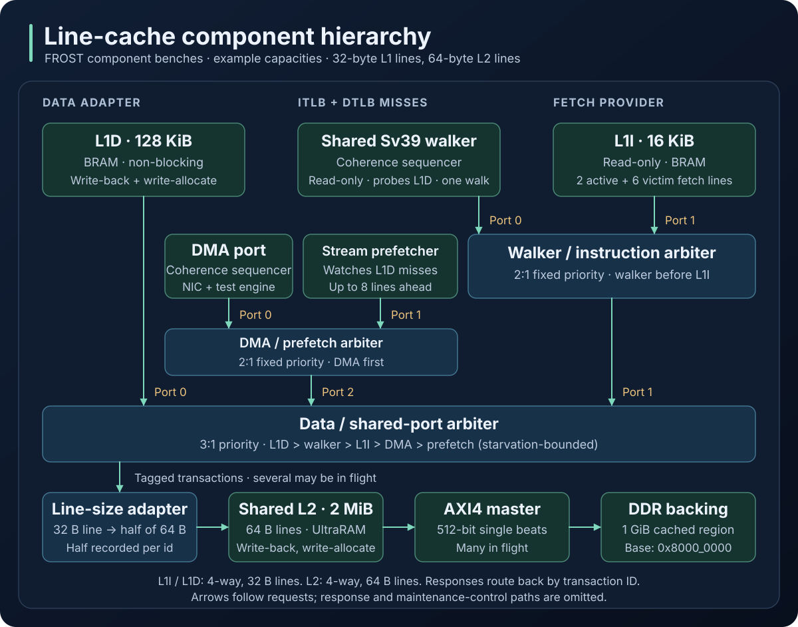

# Cache library

The CPU cache hierarchy has a private S/M L1D and L1I above a shared L2
home. The home orders acquisitions by sector, probes the L1D, merges dirty
replies through L2 and orders DMA against CPU accesses. Page-table walks
use the same home. FENCE.I drains committed stores, invalidates L1I and waits
for instruction-copy writes before flushing fetch buffers and refetching.
Refills obtain dirty private data through home probes.

The library also contains a generic nonblocking line cache, line arbiters,
size adapters, an AXI bridge and a behavioral memory model. Component
benches compose these modules independently of the CPU hierarchy.

| File | Role |
|------|------|
| `coherent_hart_cache.sv` | CPU private L1D and L1I, instruction and walker bridges, and maintenance arbitration |
| `coherence_l1d.sv` | MSI data cache with probes, tagged reads and four ordered store records |
| `coherence_home.sv` | Shared L2 home with sector ordering, dirty-data merge, configurable fills, lookup-only Prefetch service and streaming DMA placement |
| `coherence_dma_ingress.sv` | Independent DMA request lifetimes, read responses at grant and write responses after release |
| `frost_cache.sv` | Generic line cache, used by the CPU L1I and the component hierarchy benches |
| `frost_hart_cache.sv` | Private caches in the line-cache component hierarchy: the L1D and the L1I, the walker port's coherence sequencer, the probe injection register that the walker and DMA probes share into the L1D, and `fence.i` sequencing |
| `frost_cluster_cache.sv` | Shared level in the line-cache component hierarchy: the L1D, walker, L1I, and DMA ports and the stream prefetcher over the arbiter tree, the DMA coherence sequencer, the line-size adapter, and the L2 |
| `frost_cache_hierarchy.sv` | Component hierarchy for the line-cache unit benches |
| `line_size_adapter.sv` | Places each L1-line request in its sector of a wider L2 line and returns that sector of the response; an outstanding-transaction table holds each request's sector by id |
| `line_port_arbiter.sv` | N:1 tagged arbiter: fixed priority by port index, optional starvation bound, port index prefixed to ids |
| `dma_coherence_sequencer.sv` | Takes each DMA request through the L1D, and each DMA write through the load queue as well, before it reaches the L2 |
| `walker_coherence_sequencer.sv` | Probes the L1D before each page-table walk read reaches the L2; one read in flight |
| `l2_stream_prefetcher.sv` | Watches a stream of misses and reads the lines ahead of ascending streams into the L2, never past the page of the last miss; the component hierarchy's shared level has one, the coherent prefetch agent two |
| `coherence_prefetch_agent.sv` | The coherent home's source 3: two stream tables, for the hart's data requests and its instruction refills, choose lines that Prefetch requests read into the L2 through four request endpoints |
| `coherence_prefetch_pause.sv` | Holds new prefetch requests while DMA is offered or outstanding and for seven idle cycles after |
| `line_port_axi_bridge.sv` | Line port to single-beat AXI4 master; line ids become AXI ids, and each response carries the error bit of its RRESP or BRESP. The NIC's DMA master is one |
| `axi_behavioral_memory.sv` | Simulation-only DDR model: concurrent transactions, latency and jitter settings, optional out-of-order completion, and injected error responses |
| `cache_perf_pkg.sv` | Per-cache performance events: access, hit, miss, and writeback pulses, the L1D hit path's hits, hit-under-miss, the outstanding-miss count, and two stall classes; and the L2's write costs: write misses that fetch their line, and writes that wait for a read of their line |
| `*_test_harness.sv` | cocotb tops: hierarchy + bridge + memory (with a bench-paced hold on the bridge), and arbiter + bridge + memory |

## Line protocol

In the line-port hierarchy, each port between the CPU-side adapters and the
AXI bridge carries one line per transaction with a transaction id. Lines are
32 bytes from the CPU-side adapters down to the line-size adapter and
64 bytes from there to
the bridge (`LINE_BYTES` below):

```
request:  valid  ready  write  addr[ADDR_WIDTH]  wdata[8*LINE_BYTES]  wstrb[LINE_BYTES]  id[ID_BITS]  maintenance
response: valid  id[ID_BITS]  rdata[8*LINE_BYTES]
```

- A request fires on a cycle with `req_valid && req_ready`, and the slave
  captures the payload then. Slaves act only on the fire, so a master may
  change or withdraw a request that has not fired. `addr` is a full byte
  address, used line-aligned.
- A slave's ready may depend on the presented request. The bridge, for
  example, accepts a read while a write's channels are still busy.
- `resp_valid` is a one-cycle pulse at least one cycle after the fire,
  carrying the request's id. `rdata` is the line for a read and don't-care
  for a write; a write's response is its completion acknowledgement.
- There is no response backpressure. A master issues only what it can sink,
  so every response has somewhere to go.
- A master may have any number of requests in flight, each with an id unique
  among its own in-flight requests. A slave may respond in any order.
- A cache applies requests to the same line in acceptance order: a write
  accepted before a read of the line is visible to the read, and a read
  accepted before a write never sees it. Each cache is the ordering point for
  its level and never relies on the level below to order a read against a
  write. The AXI bridge gives no such order (it can issue a read while an
  earlier write still waits), so same-line ordering is the hierarchy's job.
- Writes carry byte strobes. A write that sets every strobe of the cache's
  line allocates without fetching it. In the hierarchy no write does: an
  L1D eviction covers half an L2 line, so an L2 that lacks the line fetches
  it and merges the written half (see The L2 line size). Such a write would
  install even while a probe withholds the line's fills (see Probes), so a
  cache with `NUM_PROBE > 0` must not receive one on its upstream port. In
  the hierarchy that is the L1D, whose writes come from `cached_tier_adapter`
  and cover at most one 8-byte beat.
- `maintenance` exists on cache and arbiter ports, not on the hierarchy's
  upstream ports or the bridge. It marks `fence.i` writeback traffic, which
  lower levels leave out of every performance event. It never changes how a
  request is handled.

Masters do use this freedom: the arbiters re-select among their ports every
cycle, and the walker withdraws a read when its walk is discarded. A new slave
must take no action on a request until it fires.

## Coherent endpoint library

`coherence.f` supplies the channel endpoints and their programmable harness.
`cache.f` supplies the coherent controllers and line-cache components.
The CPU filelists include their ownership and issue-control dependencies.
The endpoints provide transport and ownership bookkeeping for the home
and hart controllers.

`coherence_pkg` defines opcodes, request identity, and home identity ranges.
`FROST_COHERENCE_TYPES(P)` in `coherence_types.svh` declares packed payloads
with physical address width P, from 32 through 56 bits. Fields appear in the
following order, most significant first. Each channel also has one-bit valid
and ready signals. A transfer occurs when both are asserted. Senders hold valid
and every payload bit during a stall. Addresses name aligned 32-byte sectors.

| Channel | Direction | Packed fields and widths | Payload bits |
| --- | --- | --- | --- |
| D | Requester to home | opcode 4, q 9, addr P, offset 5, size 3, mask 32, aq 1, non_alloc 1, maintenance 1, wdata 256 | P + 312 |
| P | Home to hart | opcode 2, tid 6, epoch 1, addr P, requester 2, reason 2, check_q 9, offset 5, size 3 | P + 30 |
| R | Hart to home | opcode 2, tid 6, epoch 1, hart 1, addr P, state 2, clear 1, data_valid 1, data 256, absorbed 1, put_id 1, put_epoch 1, sc_valid 1, error 1 | P + 275 |
| W | Hart to home | hart 1, put_id 1, epoch 1, addr P, data 256, maintenance 1 | P + 260 |
| WA | Home to hart | hart 1, put_id 1, epoch 1, addr P, absorbed 1, tid 6, error 1 | P + 11 |
| G | Home to requester | opcode 3, q 9, tid 6, addr P, data 256, error 1 | P + 275 |
| C | Requester to home | q 9, tid 6, addr P, status 2, write_done 1 | P + 18 |
| U | Home to requester | q 9, tid 6, addr P | P + 15 |

Request identity q contains src 2, port_class 2, id 4, and epoch 1. Sources
0 and 1 name harts, 2 names DMA, and 3 names prefetch. Classes 0, 1, 2, and 3
name data, instruction fetch, page-table walk, and agent traffic. Hart data
IDs are 0 through 7, and fetch and walk IDs are 0 and 1. DMA IDs are opaque
four-bit values; prefetch IDs are 0 through 3, one for each request endpoint
of the prefetch agent. Admission limits are the ingress's credits for DMA,
eight in the cluster, and the agent's endpoints for prefetch:
`L2_PREFETCH_INFLIGHT` data identities, three by default, and one instruction
identity. Admission arbitration is external to the endpoint slots.

Home tid is six bits. For H harts, `completion_count(H)` is `12*H+12`: twelve
identities per hart, eight DMA credits and four prefetch identities. The
last four slots take only prefetch requests, as many as the prefetch
identities, so a prefetch never takes a hart or DMA slot.
`fill_base(H)` equals this count, `put_base(H,F)` adds F fill controls, and
`home_count(H,F)` adds two PutM controls per hart. H is 1 or 2. Home identities
must fit 64 values. Elaboration rejects invalid geometry and identity
parameters, including values that would truncate to another identity. A completion endpoint's TID is in the completion range;
fill and PutM controls have separate lifetimes. The epoch denotes cluster
reset. Every endpoint resets together, and its epoch input is stable during
operation. No coherent packet may survive reset. External response debt must
be drained or discarded before identities are reused.

The request and PutM endpoints, line bridges, channel arbiters, the L1D, the
home's completion table and endpoints, the arrays and the DMA ingress apply
reset at their flops, and their combinational outputs have no reset term. An
output can be live in the first reset cycle, when every receiver on the same
reset ignores it. The arrays' tag and replacement writes, the home's memory
request and the DMA ingress's request readiness keep a reset term, because those
RAMs have no reset, the AXI bridge can keep running through a CPU reset, and a
DMA requester has its own reset.

| Encoding | Values |
| --- | --- |
| D opcode | 0 GetS, 1 GetM, 2 LoadReserved, 3 Atomic, 4 StoreConditional, 5 ReadOnceIF, 6 ReadOncePTW, 7 DMARead, 8 DMAWrite, 9 Prefetch, 10 GetMZero |
| P opcode | 0 ProbeRead, 1 ProbeInvalidate, 2 CheckSC |
| R opcode | 0 ProbeAck, 1 ProbeData, 2 CheckAck |
| G opcode | 0 GrantS, 1 GrantE, 2 GrantM, 3 GrantData, 4 GrantAck, 5 GrantFail, 6 GrantMZero |
| C status | 0 Consumed, 1 Killed, 2 Error |
| MESI state | 0 Invalid, 1 Exclusive, 2 Shared, 3 Modified |
| Probe reason | 0 Read, 1 Write, 2 Replace, 3 Check |

Unlisted values are reserved. W, WA, C, and U implicitly mean PutM, PutAck,
Done, and Release. Size is log2 bytes. Offset and mask select bytes within a
sector. Hart write operands stay local; DMA writes use D.wdata and D.mask.
ProbeData and data-bearing grants carry a complete sector. Error overrides
permission installation. GrantFail grants no permission. GetMZero and
GrantMZero carry a cbo.zero block (see Line-scope cbo.zero). These encodings
describe messages; the endpoint library does not implement MESI transitions.

`coherence_request_endpoint` reserves one request identity, a grant register,
and completion storage at local request acceptance. SOURCE, PORT_CLASS, and
SLOT select that identity. Separate instances provide independent D, IF, and
PTW credits. The local caller reserves installation storage before
presenting a request. The L1D's endpoint 0 also reserves a dirty-victim slot
through installation; a nonzero endpoint's grant installs only while a slot is free. The endpoint holds D through acceptance and
captures a matching G by q and address. The local grant consumer then sends
Done. The endpoint keeps its identity through C and the matching U, including
killed reads. GetM, Atomic, and StoreConditional reject killed completion and
require write_done for a successful operation that grants permission.

`LOCAL_PHASE_UPDATES` selects separate phase occupancy registers. Each
handshake updates its departing and arriving phases. The default selects
an encoded phase register. The L1D selects local phase updates for every
endpoint when stream requests are enabled. Both forms have the same
handshake boundaries and payload lifetime. The endpoint equivalence harness
compares both forms against an independent encoded reference after reset,
including ready signals, phase occupancy and payloads on invalid cycles.

`coherence_home_endpoint` reserves one TID at D acceptance. Its programmable
service sees `o_work` and supplies `i_result`, a complete G payload held until
`o_result_ready`. That transfer is the G transfer. The service reserves the
result source before admitting D. The completion record stores metadata;
Grant data stays in the service's reserved source until the requester's grant
register captures it. The dispatcher prevents duplicate live q values across
records. A record accepts C only after G and emits U only after C and every
registered absorbed-PutAck dependency. It becomes available on U consumption.
The caller owns the line lock and destination pin through that edge.
The pending mask is empty in Idle and SendU. Reset clears the mask, and each
accepted absorption or cancellation updates its keyed bit.
Completion identity and address comparisons use parallel three-bit groups.
Hart completion payloads select with local endpoint phase indications, which
are the endpoints' channel valid signals.

The home service registers an absorbed R through `i_absorb` after preserving
its dirty image in a reserved sink. This port records cancellation metadata;
it does not store R.data. `i_cancel_valid` denotes the successful consumption
of an absorbed WA. It is an event, with the WA payload on `i_cancel`.
Matching includes hart, put_id, epoch, address, and TID. The record remembers cancellation before or on the absorption
notification edge. The service registers all absorptions before or on the G
transfer edge. Repeated absorption of one slot
within a completion is rejected. A failed WA leaves its dependency pending.

`coherence_put_endpoint` freezes one full sector until WA. HART and SLOT
select one of two slots per hart. An ordinary W transfer wins a simultaneous
absorption claim. An absorbed slot keeps W presented, and the home must mask
ordinary selection until the absorbed WA handshake cancels it. WA ready
certifies removal of that exact slot on the edge. `o_cancel_valid` reports
successful cancellation; another slot may keep the shared W port valid.
Ordinary WA is accepted only after W. Error WA preserves the frozen bytes
and asserts fatal until reset. The home holds an ordinary PutM's line lock
through successful WA consumption.

Error C and every completion of an error grant require `i_error_disposed` at
both endpoints, including killed reads. The service asserts it
only for an error whose ownership is safely disposed. Dirty data and failed
retired stores require fatal handling with ownership held through cluster
reset. Error grants cannot complete as Consumed. A killed read can discard
its grant without installing permission.

`coherence_channel` is a one-entry registered queue with no fall-through or
simultaneous refill. Separate instances hold P and R independently of demand
and PutM slots. Probe service, grant production, completion delivery, and
release delivery require independent service resources. Debug halt and WFI
must not stop those resources in an integration.

## Coherent one-hart cache path

`coherent_hart_cache` contains the L1D, read-only L1I, instruction and walker
bridges, and maintenance arbitration. `coherence_home` contains the shared
L2 controller and `coherence_home_array`, whose tag, data-read and masked-update
ports have independent service. The L1D's `coherence_array` serializes its
lookup, read and update operations in block RAM. Its data array has a bank
per way, rows by set. The final tag-read cycle selects the private way, and
every bank reads the set's row in that cycle; the banks' output registers are
the second cycle of the read latency, and a way multiplexer passes the
selected way's row to the response. With `HIT_PORT`, the array also has a
hit port: a copy of the tags, written with them, and the banks' read address
in every cycle but a data-reading lookup's final tag-read cycle. A request
taken with `o_hp_ready` reads the copy and every bank's row of its set on one
edge; its hit shows two cycles later and the hit way's dword a cycle after
that, both as of that edge. The port is not ready in that tag-read cycle, in
a cycle that writes its set, or before the reset sweep ends. Victim selection uses the tag request's
matching PLRU response. Each tree bit of the replacement state has its own
RAM, and a touch writes only the bits on its way's path. A hit writes them
from the registered way during data service or the reply, before
another request or update can enter. A hit-port hit writes its way's bits in
its third cycle unless the array writes replacement state in that cycle, which
drops the touch. A lookup marked `i_req_no_touch`
leaves replacement state unchanged on a hit; the L1D marks look-ahead
lookups this way. The L1D's array uses bimodal insertion (see Sets and ways),
and `i_update_touch` makes one insertion update replacement state. The L1D
sets it for a fill with a read attached to its endpoint or another miss of its
set not yet installed, which moves the fill off its set's next-victim position
before the next installation in the set. Any other fill keeps bimodal
insertion.
An insertion update uses the most recent lookup's set and selected way;
the controller completes that update before issuing another lookup.
The L1D asserts this pairing for each grant installation.
Response data is meaningful only with `o_resp_data_valid`. A tag-only or
skipped read keeps the prior response data without reading the data array.
A lookup marked `i_req_tags_only` reads no data and replies after the tag
read, so it leaves the banks to the hit port.
A lookup marked `i_req_data_if_hit` needs data only on a hit, and one
marked `i_req_data_if_victim_modified` only when it misses and its selected
victim is Modified; a maintenance visit always waits for its data.
Otherwise such a lookup replies without data in the first data-read cycle,
from the registered tag result, and its data read goes unused; a reply held
past that cycle keeps its contents until consumed. The L1D marks CPU read
lookups with the first flag, so a read miss is known after the tag read,
and grant installation lookups with the second, so only an installation
that freezes a Modified victim waits for the data read.
The L1D uses 32-byte sectors; the L2 supports 32-byte or 64-byte lines.

Reset clears every set's tags, coherence states and replacement bits in both
coherent arrays, then drains the metadata writes before accepting requests.
Data RAM is not cleared. In simulation, `SIM_FAST_MAINT=1` clears that metadata
in one cycle after an observed reset. Its write drain covers the data RAM
input pipeline before requests resume. Hardware uses the per-set sweep with
`SIM_FAST_MAINT=0`.

The L1D has I, S and M states. Reads use S or M. Four ordered committed
store records own 32-byte sectors after SQ acknowledgement. Each accepted
scalar store receives one acknowledgement. A store combines only with the
newest unsealed record of the same sector. Byte masks select the most recent
value of each written byte. A record holds at most 32 contributors and seals
at that limit or when selected as the head for installation. A simultaneous
contributor is included before sealing. A, B, A stores occupy separate records.
New-record metadata decodes the next free record directly; combining selects
the youngest record separately. A zero write always allocates and aligns its
lower record to the 64-byte block.
Launch credit reserves an arriving scalar without comparing its address or
borrowing a simultaneous installation. The lookahead scheduler samples physical
record conflicts before selecting by age. Queue changes invalidate that sample.

Only the head installs. A Modified hit uses a tag-only lookup and the array's
byte enables. A buffered successor can start its lookup after the head's
masked update completes. Registered read demand gives a waiting data read a
turn between store selections, including permission misses. Eligible demand
load grants share that turn; a speculative grant does not take it. Lookahead
lookups and store grant
installations also yield to waiting reads. Probes and atomic operations have
priority. A selected array operation completes before probe capture; queued
bytes and held grants are excluded from probe replies.

Four sector holds block local loads until their records install. Atomic
ownership uses the first hold while the ordinary store records are empty.
The first hold captures store and atomic addresses on their ownership edges
and restores the stored sector address when atomic ownership releases.
SQ launch readiness reserves a record for the next cycle's registered write,
including an arriving write and a simultaneous maintenance request. A
simultaneous pop supplies no speculative credit. Every scalar launch
invalidates its dword in the LQ's L0 cache. Fences and publication drains
wait for all store records to install. A resident Modified atomic needs
endpoint 0 and its own sector free; home SC and AMO acquisitions and
maintenance wait for every request endpoint to release. LR uses the
committed-store drain and its endpoint and sector checks.

There are eight unmerged CPU read slots, two frozen PutM slots and `MISSES`
request endpoints, set by `L1D_NUM_MSHR` and eight on X3. Endpoint 0 carries
the head store's GetM, LR, AMO and SC acquisitions, and ordinary loads when it
is the only endpoint; the others carry ordinary load misses and optional
speculative GetS requests. With at least three endpoints, a nonzero endpoint can
carry a lookahead store GetM. At most one nonzero endpoint is lent to a store.
There are at most two live store acquisitions, including installed requests
awaiting U. A reader ordered behind a lookahead store can keep that store's
home fill occupied until the store completes, so the head store's acquisition
needs another fill. With three or more L1D endpoints the home needs at least
two fills; `cpu_top` and the cluster test harness reject a one-fill home.
Each endpoint owns its grant and completion metadata through U; a popped queue
record can be reused independently.

Lookahead prefers another home row over the head's sibling sector. Only the
oldest queued record of a sector may acquire, and no live endpoint or frozen
PutM may hold that sector. A younger different row cannot acquire in the same
home set as an older queued or live store. `HOME_CACHE_BYTES`, `HOME_WAYS` and
`HOME_LINE_BYTES` match the connected home. A lookahead Modified hit waits
for a fresh lookup at the head. A miss classification proceeds directly to
endpoint capture without an intervening private installation.

Store-head eligibility is checked before priority. A registered store-owner mask
follows the head on installation and includes accepted acquisitions.
A registered head address follows empty insertion and head promotion.
Grant selection reads each endpoint's grant phase flop. Nonzero grant
candidates share free writeback
credit; endpoint zero uses its reserved credit. `coherence_grant_select` applies that shared credit after
choosing the first nonzero candidate. For binary inputs, its outputs match a priority scan over
all credit-qualified candidates. The same selection qualifies the endpoint
failure bit. Owner, failure and error fields and the packet use the nonzero
priority decision before shared credit qualification. Endpoint zero's selection
takes the packet ahead of it. An idle decision reads endpoint zero's fields,
and a packet without a selection goes unread.
A younger store grant waits
in its endpoint while the head and eligible reads continue. Endpoint 0
reserves a free dirty-victim slot through installation. A nonzero endpoint
requires a free slot when its grant is selected. Endpoint 0 does not take the
last free slot from a waiting load grant, a nonzero endpoint in its grant phase
that carries a load. `coherence_miss_credit` computes this permission and the
Load, LR and AMO retry credits from that indication, endpoint ownership,
writeback occupancy and drain state. LR and AMO retries read their credits from
a flop per read slot, and their lookups recheck the credit before acquiring. Frozen slots remain occupied through
WA. A store error stops the hart without read completion or error disposal.

A demand grant on a load endpoint answers its load from the captured grant in
the grant's first lookup cycle, before installation, so the answered read slot
can hold a later read while the line installs; that read becomes selectable
when the installation completes. Endpoint 0 answers its reads after
installation. A load endpoint's Done, and the loads waiting on it, follow
installation.

With stream look-ahead enabled, a successful demand installation
with a reader waiting on that endpoint gives an eligible ordinary read one
service turn before another load grant. The circular read selector chooses
the read but keeps its pointer, so a read that misses on this turn keeps its
place for the next ordinary selection.
The credit is consumed at the first probe-free grant-deferral opportunity,
read lookup start or grant acceptance. An empty opportunity lasts one edge.
Probe ownership preserves unused credit, and its following local turn bypasses
deferral. Atomic work and maintenance cancel the credit. While a grant is
selectable, a credited read may hit or attach to a live endpoint; its miss
waits to start an acquisition.

No two live endpoints hold the same sector. A load miss on a sector held by
an endpoint waits for installation, or for release if the installed sector
has been replaced, then looks up again. Load and lookahead acquisitions stop
while an atomic is active or an AMO, SC or maintenance operation waits for
admission. Contending eligible load misses and lookahead acquisitions alternate
successful allocations. Permission lookups precede endpoint-allocation arbitration.
A lookahead miss that yields its allocation remains eligible for another lookup.
Read hits do not clear the allocation turn. They permit
store borrowing when no eligible load miss waits. A read miss can finish a lookup
before yielding endpoint allocation to lookahead. A lookahead Modified hit
consumes no endpoint and yields its allocation turn. A yielded read miss reserves
lookahead service ahead of head-store hits. The reservation ends after lookahead
service, endpoint allocation, record promotion or removal, or an atomic or
maintenance drain request. Each acquired
store record contributes to the outstanding-miss count until installation.
The L1D registers read ownership from acquisition, installation and release
events. `coherence_read_owners` computes the same mask from parallel endpoint
contributions as a checking reference. Endpoint zero excludes stores and SC;
nonzero endpoints exclude stores, hints and installed requests. Duplicate
endpoint slot indices combine by OR. The binary mask matches an indexed
endpoint scan. A read's wait for another acquisition of its line, the flag for
a free load endpoint and the flags for waiting LR and AMO reads register from
the same kind of events.
SC acceptance and local atomic admission do not read the SQ's write decode:
the CPU presents an atomic only after its committed stores drain, so no store
arrives beside them.

A fatal stop reaches the L1D controller through one flop and takes effect on
the cycle after it rises, so no selection or capture enable starts at the
fatal logic. The CPU's retirement stop takes effect on the cycle after the
failure. An endpoint accepts every acquisition while idle, so the
controller reads the endpoint's idle state for acceptance. The lookup address,
selected read slot and grant payload have no reset and capture on every Idle
cycle, because nothing reads them until a selection leaves Idle. The read
address joins that selection last. The priority conditions above a read are
prepared separately, so read eligibility controls the final address selection
without passing through the non-read address priority chain.

Read status uses per-slot masks for allocation, response transfer, lookup
results and grant completion. Completion and miss sets dominate allocation
clears. Allocation sets dominate response clears of valid bits. A failed
read completes on the cycle after its grant, from registers that hold its slot
and error bit, and its waiters' waits end on the same cycle. Status outcomes
are computed with and without allocation. The allocation pulse selects the
outcome.
Lookup history and wait flags also compute their updates with and without
allocation. Allocation clears lookup history and, with multiple request
endpoints, the wait flag. These clears take priority over lookup and wait
attachment updates on the same edge. The attachment endpoint and release flag
capture independently of this clear.

`coherence_read_stream` tracks one ascending stream from CPU permission
lookups. Three adjacent ordinary load misses confirm the stream. Before
confirmation, an adjacent miss advances the seed and an adjacent hit leaves
it unchanged. Demand hits and misses on the next sector advance a confirmed
stream; a nonadjacent miss replaces it.
Repeated accesses and retry lookups do not advance it. Look-ahead stays
within eight sectors and within the current 4 KiB physical page.
`STREAM_PREFETCH` defaults to zero in the generic L1D. The hart's cached
window is the Normal DDR PMA region, and the hart enables look-ahead when
both ends of that window are page aligned.

At most two of the highest-numbered load endpoints carry speculative GetS
requests. Three-endpoint caches allow one; smaller caches disable look-ahead.
Demand may use every load endpoint. Eligible foreground work precedes hint
selection. Registered hints check live acquisitions, buffered stores and
frozen dirty writebacks, with conflicts rechecked before acquisition.
The recheck reads a registered comparison, and any offered probe excludes the
hint. A store that arrives on the acquisition edge or the edge before it is
not compared. It waits for the endpoint like any store that arrives while the
endpoint is live.
Nonzero endpoints receive GetS payloads with zero write masks. Demand size
and offset follow the selected load. Endpoint zero carries the other
acquisition kinds.
Only the speculative endpoint pool uses the conditional hint acceptance
guard. Endpoint zero and the demand-only endpoints use demand admission.
The hint and selected lookup have separate comparisons against live ownership.
The registered lookup comparison qualifies the tag decision and endpoint
acceptance. Only the prefetch can start an acquisition or a writeback while it
runs, so that comparison covers live ownership at acceptance.
A speculative tag decision checks the page and look-ahead window. The selected
address and demand frontier stay fixed through acquisition, which checks
cancellation at endpoint acceptance.
A resident hint needs no acquisition and leaves the sector's replacement
state unchanged. Accepted speculative identity lasts through U, including
when a CPU load attaches to the endpoint.

Speculative grants install Shared data through the ordinary victim and
probe service. They do not own a read ID, modify demand response data or
complete a CPU load. An attached load repeats permission lookup after
installation. A clean speculative read error is disposed through C and U;
an attached demand then retries and determines its own result. Dirty
writeback errors are fatal. Registered admitted LR or AMO work, selected
atomics, SC, local maintenance, reset and fatal stop cancel unaccepted hints.
A hint offered to its endpoint on the cycle a fatal stop rises is accepted,
because the stop takes effect on the next cycle.
One hint may be accepted on the LR or AMO admission edge. Its endpoint owns
the request through D, G, C and U, including channel backpressure. LR may attach to a speculative
fill; home AMO and SC acquisitions and local maintenance use the endpoint
drain rules.

An L1D grant belongs to a live request endpoint. Its endpoint compares the
grant's full address in parallel byte groups before qualifying acceptance
with the request identity and opcode. A partial final byte is included.
SC acceptance requires
endpoint 0 to be idle and excludes a selected grant. Grant processing and
SC acceptance are mutually exclusive. Probe capture and service own local arbitration through R
acceptance. Invalidation admission starts on P capture and keeps the captured
address until the CPU accepts admission. Ready grants, writes and maintenance request one local selection
edge after R acceptance. An eligible read requests a turn after four completed
probe replies. Grants and atomic writes take priority within that turn. A waiting data read
can use the turn between hit-store installations. A selected local operation
completes its array service before P is accepted. A local Modified atomic holds
service from lookup through write installation and a registered release edge.
This includes SC result consumption and retirement. Resource retries and home
permission waits release the probe port. A withdrawn local offer releases its
turn after one edge.
The array uses the highest matching valid way for hit state and modified-only
data service, including a matching way in the replacement exclusion mask.
A miss has no modified hit. Skip-on-hit suppresses hit data even for a
modified-only request; a maintenance visit always reads its selected row.
Read-slot payload writes pass through a one-record buffer. The buffer
captures the payload and a slot mask each cycle. Reset clears the slot mask
through its data input. The mask identifies the allocated slot
and is zero without an allocation. It qualifies forwarding
and writes to the slot storage. The forwarding mux
makes each allocation visible on the allocation edge. Each slot keeps its
allocated payload until reset or another allocation to that slot.
Allocation marks an empty slot valid. Read eligibility compares each physical slot with pending, atomic and frozen
writeback sectors on 18 sector index bits. An alias waits for its holder like
a match, and holders do not wait for reads. The comparisons use the stored slot addresses and the
buffered allocation's address, and the slot mask selects between their
results. Availability and load-miss demand each reduce stored and
buffered-write candidates separately.
Both masks are qualified by endpoint ownership, waiting status and miss
retry credits. The shared write-address exclusion qualifies the
buffered-write result after the candidate reduction.
Circular priority selects a qualified slot and its address.
Loads also have a hit path beside the controller. In the cycle after a load
arrives, the L1D offers it to the array's hit port from registers, unless a
probe is in service, an owner holds its slot, or a holder blocks its sector
by the rule above. A hit completes the slot's read four cycles after its
arrival, and the response leaves like any other. In stage 4, as the hit path
answers it, the slot is out of read selection. A read that the controller
selects while the hit path holds it, including one selected in its stage-3
cycle, gets a shadow lookup, which reads tags only, leaves replacement state
alone and answers nothing if either lookup hits; a read that misses both takes
the miss path from that lookup.
Hit-path hits train the stream detector through two entries on its second
input, which it compares apart from the controller's load reports and takes
in cycles without one; a hit only advances a confirmed stream, and one that
finds both entries full is dropped.
There are no E grants, silent upgrades or sharer hints.
The L1D has eight read slots and `L1D_NUM_MSHR` request endpoints.
The home has `L2_NUM_MSHR` fills, 1 to 16, and `L2_NUM_WB` victim write
slots. `L2_NUM_WAITERS` has no effect on the CPU hierarchy; `L2_PREFETCH`,
`L2_PREFETCH_DISTANCE` and `L2_PREFETCH_INFLIGHT` configure the home's
prefetcher (see The home's prefetcher).

L1D performance events count scalar CPU requests. CPU reads count at their
first permission lookup; a read that the hit path answers counts as an access
and a hit when it is answered, and its shadow lookup adds nothing. The first
store in a record counts at its first permission lookup; each additional
scalar that combines counts as an access and a buffer hit on acceptance, even
before permission arrives. A combined
store and a tag lookup can contribute two accesses in one cycle. Cached SC
counts its first definitive classification: a Modified hit, including a failed
reservation, is a hit; a home acquisition is a permission miss. A first store
to S requires permission and counts as a miss. AMOs on Modified sectors count
as hits; other AMOs count as permission misses. Repeated lookups, probes,
speculative lookups and maintenance do not add demand events. Outstanding misses include unresolved
read misses, acquired store records, the head store waiting to acquire after
a miss, and an SC classified for home acquisition. L2 events
count shared demand lookups, the L1D's speculative GetS lookups, prefetch
lookups and non-maintenance PutM lookups. Private writeback events include
speculative fills that evict dirty sectors. Its fill count, prefetch fills
included, is at most `L2_NUM_MSHR`. A prefetch that allocates nothing is not
a slot-full stall; a blocked one is a conflict stall. A DMA write miss
contributes a write-fill event; probe data
merges do not contribute another demand. Events are registered at their
source and use the cache-counter ABI.

The hart uses source 0 and classes 0, 1 and 2 for data, instruction and walker
requests. The data class has one request identity per L1D endpoint, IDs 0
to `L1D_NUM_MSHR - 1`. The instruction and walker classes each use IDs 0
and 1 for two bridge slots. Each IF slot saves its L1I MSHR ID separately
from its coherent identity. IF and PTW data and errors register at G, after the
home has merged dirty probe data. Each slot completes C and U independently
of its reader response and accepts another request only after U. Each class's
two slots share staged D/C arbiters and return at most one response per cycle.
Their G readiness uses the registered phase and full q match. The home admits
at most one live request per q and returns that request's address in G.
An assertion checks the address of every accepted grant.
`coherence_line_bridge` defaults to a response after U for other users.

Source 2 and class 3 identify
DMA, whose four-bit ingress ID occupies q.id. `coherence_dma_ingress` has
`SLOTS` admission credits, eight in the cluster, and holds each opaque ID
until its slot frees. It presents requests in acceptance order without waiting for earlier
grants or releases. Each slot independently owns its request, grant, completion,
release and external response. G matches the full q and address; U also matches
the granted tid. A slot offers C from the cycle after its G, and a fair
arbiter captures the selected slot's C metadata and holds its presentation. A read's G carries its
final data, so the read responds from the cycle after its G; a write responds
on the cycle after its U. One response goes out per cycle, the U's slot first,
so no response comes later than the cycle after its U. A slot and its opaque ID
return at the later of the response edge and the U.
Different sectors can complete out of order. The AXI bridge buffers read lines
by ID and presents AXI read beats and write responses in burst order.
Channel arbiters capture the payload with the selected input and hold both
through a stalled presentation.
The home's probe, tag, update, result and PutAck arbiters use their captured
selection for validity. Each selected source holds its offer through acceptance.
A stop reaches the home through one flop. A home failure stops the home on
the edge that sets its fatal indication, and the fatal stop input takes effect
on the cycle after it rises. The stop suppresses probe and PutAck validity and
further array requests. Internal home and engine state changes are qualified
by that stop alone, because reset clears every register they update.
Read arbitration selects pending read offers with its held one-hot mask in
four-port groups, then combines the group results.
Home stop clears its unaccepted selection. Accepted reads keep their tokens
through physical completion. A local fatal transition cancels an unaccepted
read.

The home admits twenty-four requests with distinct identities: twenty
hart and DMA requests, and four prefetches in four slots kept for them, so
neither kind waits for the other's capacity. Eight engines
share their image storage with the result credits. An engine hands its image
to completion ownership before G. A ninth result buffer, the forward buffer,
holds a fill's forwarded result, and its sector waits in a register of the
home. An idle grant register captures an accepted
result directly when no older result awaits selection; otherwise it takes the
next waiting result in rotation over the nine result buffers, whose stored
tid names the slot. The grant register presents G while it holds a grant. G
acceptance returns that image credit; the identity and physical way pin last
through U. Each request waits for
earlier requests to the same 32-byte sector: for a hart request's U, and for a
DMA request's result. A DMA requester keeps no copy, and its result follows its
probe service and array update, so its G, C and U order nothing after it. A
prefetch changes nothing a client sees, so it neither waits for nor orders
other requests.

`coherence_home_array` has separate tag-decision, data-read and masked-update
ports. Each request carries a response token. Replacement state changes when
the consumer claims a tag decision. An available miss response selects an
unpinned way. Way claims enter through the tag response port. Put and writeback address
hazards are checked at response acceptance. Tag updates exclude an unresolved lookup
of the same physical packed row. A pending tag update blocks further lookups
to that row until the update is accepted. Data hazards cover the read sample and the
write input registers through completion. Contending reads and writes alternate
service while prior operations drain. Masked updates preserve sibling sectors.

The D channel's `non_alloc` hint restricts miss replacement to way 0.
A streaming request that needs a replacement waits while way 0 is pinned.
Hits use their resident way, including ways excluded from replacement.
DMA reads and writes use private-cache probes and dirty-byte merging
through the same service path as allocating requests. The hint controls
replacement placement. Misses fetch and install cache lines, and
unrestricted requests may allocate in any unpinned way.

`L2_NUM_MSHR` fill controls own memory-read IDs 0 to `L2_NUM_MSHR - 1`. A
fill has three read waiter seats. A demand fill's primary request, the
request whose decision allocated it, takes the first; a prefetch's fill
starts with none. Parked requests release their engine and
image credit. A request waiting for a way or resource retries from completion
metadata.

A primary GetS, LoadReserved or GetM, whose hit service would read the row
and send no probe, is granted from the fill's line. Once the fill holds its
line and its victim handling has let the install begin, the fill offers the
primary's sector; fills that may forward take turns. The selector forms its
blockers in groups of three ready/preferred pairs before reducing the groups.
Each fill records its primary's identity at allocation, so the forward's
result comes from the fill's registers. The completion table accepts the
forward while its forward buffer is free: the primary's slot leaves its seat
and takes its result, its completion pin on the fill's way and the forward
buffer on one edge, and its G follows as any buffered result's.
The fill blocks its whole line until the install completes, so a
PutM, a probe or a replacement of the line waits for the install, and the
G can precede it. Every other primary, and every waiter, takes the path
below.

A successful fill wakes its waiters on the cycle after the array
accepts its installation update, and admits no waiters from then on. The
wake leaves out a primary that waits for its forward; that primary keeps its
seat, and the fill its line, until the forward is accepted. A waiter
whose tag decision precedes the installation's completion finds the fill
blocking its line and retries without parking. Waiters reenter array and probe
service in sector order and sample the current resident bytes.
A successful fill's way pin lasts until its install completes and its final
waiter, or its forwarded primary, has taken a completion pin. A failed fill
wakes every seat, its primary included, with the error, transfers its error
to completion metadata and releases its control before the waiters dispatch
in sector order.

Fill waiter ranks are independent of the available-seat count. A balanced
prefix network counts up to three eligible entries before each candidate. Each fill
stores its occupied seat count beside the seat mask. Allocation, joining
readers, handoff, a forward and error cleanup update both on the same edge.
Seat joins, retirements and error cleanup keep their priority over allocation. The mask prepares the
allocation and non-allocation outcomes before selecting between them; zero
fill images likewise clear through their data input.
A joining
engine uses one seat before the queued waiters. Ready work precedes other
eligible work. Both classes compute their circular priorities independently
before selecting an encoded winner. The prefetch slots share one place in
that rotation, after the other slots; it offers a prefetch slot chosen in
rotation among them on the previous cycle, leaving out the slot being
dispatched. Work selection uses registered parking
state. A selection captured with a simultaneous fill park is canceled before
allocating an engine or image credit. The tag decision carries its captured
query address through conflict and replacement checks. Engine address pins
exclude valid victim lines. An invalid way's stored tag does not create an
address conflict; physical way pins and fill claims govern its reuse.

Two ordinary PutM controls have frozen payload storage and independent array
service. Round-robin arbitration rotates tag decisions, row reads, masked
updates, probes, acknowledgements and results. Resident data reads overlap
probes. Dirty probe bytes override the resident snapshot regardless of arrival
order; DMA byte enables apply after that merge. The final service edge
combines every completed input before the masked update or result becomes
eligible. Error replies preserve dirty ownership. Probe replies have
separate ownership from CPU reads, pending stores and PutM presentation.
A pending probe reply prevents local grant selection until R acceptance.
Grant application requires the private request endpoint to accept the grant.
A ProbeRead of M merges dirty bytes and leaves S. ProbeInvalidate leaves I
after the CPU cut. CheckSC returns the selected reservation result.
An ordinary probe starts its tag request on P capture when the array is ready.
Its reply forms on the edge that applies its state update, or on the lookup
edge when no state changes, once the required cut is done. A state-only array
update needs no data-write wait. A held R preserves its payload and prevents
another P capture.
The reply's set condition is prepared from the lookup, update and reply phases
before R readiness clears its valid bit. A simultaneous new reply takes priority
over acceptance; reset clears the valid bit in its own flop.
CheckSC samples the reservation after capture.
Probe lookups read private data only for an M hit. A clean read probe leaves
the tag and bytes untouched. A downgrade or invalidation updates the tag
without writing the data row.

Every M sector has a resident L2 merge destination, or a fill that blocks
its line until the destination is installed. Clean S and L0 copies
may outlive an L2 replacement. Replacement recalls every victim sector
without a directory hint, merges dirty replies, and freezes the complete
victim image before reusing its row. A valid victim reserves one of two
writeback slots before its first recall. Detached writes use memory IDs 16
and 17. The physical address stays locked until
a successful memory B response. A failed fill cannot expose the detached
victim tag. Grants pin their destination through C and U. An absorbed PutM
keeps its exact slot and epoch until WA cancellation. A completion with no
pending cancellations becomes eligible for U on the following cycle. A fair
arbiter holds each U presentation through acceptance. An ordinary PutM
owns its control through WA. DMA reads collect dirty private data; DMA
writes merge only their selected bytes after invalidation.
An L2-resident DMA read with no dirty probe data returns the resident image
without a data-array write. Fills and dirty replies reach the array before
the home grants the read.
A resident DMA write reads the L2 tag and writes its byte enables without
reading the data array. A dirty probe supplies the complete private sector
before those byte enables apply. The update preserves bytes outside its mask
and every byte in the sibling sector. A miss reads the victim and fills the
requested row before applying the write. GrantAck has zero data.

The home arbitrates held probe packets from engines and fill controls.
The fatal stop qualifies probe service. The L1D computes incoming invalidate
eligibility from its phase, probe occupancy, reply occupancy, opcode and fatal
stop. Probe validity qualifies that eligibility before it combines with the
resident invalidation hold.

The CPU cut stops local load launches at invalidation-probe capture. No read merging
crosses the cut. The capture address marks matching response owners before
that edge, preventing an L0 fill or LR reservation from a crossing response.
An unrelated LR keeps its reservation eligibility.
Invalidation covers L1D, L0, live read slots, reservations
and returned-load observations held until retirement. Delayed invalidated
LR responses cannot establish a reservation, and stale responses cannot
refill L0. Loads blocked by a pending store or selected atomic are parked so
that unrelated rows can issue. Cut admission and replay marking run in
parallel with the probe's array lookup and state update. The probe reply
waits for both operations. An admission answer is clean when the CPU holds
nothing for the line: no L0 entry at its dword indices, no cached load or
reservation on it, and no live or pending observation of it. A clean cut
skips the CPU invalidation and its wait: its global issue gate ends at the
clean answer, since nothing needs replay marking, and its reply still waits
for the array lookup, the state update and any write-back absorption.
Otherwise the global issue gate ends after replay marking is effective. In
both cases the matching-sector gate lasts through reply acceptance.

The atomic guard arms when idle on a candidate whose tag is the valid ROB
head, unless an entry vetoes it in that cycle. An active guard retires on its
commit and releases once retired or faulted with the home idle. The guard
registers those inputs as they arrive, at the end of the ROB head's commit,
trap and xRET logic, and forms its active and retired outputs from the
registered values on the next cycle, which equals registering its next state.
The atomic guard captures the candidate tag while idle and holds it while
active. Only an active context qualifies the tag.

Cached SC and AMO requests on resident Modified sectors complete locally.
The L1D checks registered lookup results after older stores have installed,
with endpoint 0 idle and no same-sector acquisition or frozen writeback.
It holds the service engine through the read, tagged write, array installation
and registered release. Probes, grant installation, replacement and maintenance
wait during that interval. The saved sector image supplies the masked write.
A local atomic allocates no home identity and sends no C or U.
A Modified hit blocked by a same-sector endpoint or frozen writeback repeats
its lookup until that conflict clears. SC retries take priority over reads
between those lookups, which can delay unrelated array service.
The atomic address, size and tag are captured at SC acceptance or AMO
classification. A local AMO also captures its read slot. The owned context
holds through installation and release.

The CPU arms a tagged ROB-head context before cache presentation. The active,
unretired context identifies a valid ROB head. Interrupt and debug entry
cannot cancel that context. Protection ends after both retirement and release.
A fault in the selected instruction releases the context only after cache
ownership ends. A completed single step prevents the following atomic from
acquiring ownership.

Local SC checks its exact physical reservation address and W/D size before
success. Failure returns one result without a write. Success holds pending-write
ownership through result delivery, retirement and the tagged SQ write. An
interrupt or debug drain cannot stall the protected owner's retirement. The
reservation clears at write installation. The CPU's older-store drain, AMO
load dependencies and invalidation replay rules order every aq/rl encoding.

All other atomics acquire through the home after draining the endpoints.
SC checks its reservation after home resource entitlement; a passing CheckSC
uses a self-ProbeRead to collect dirty data without cancelling its reservation.
The home lock spans the SC's tagged SQ write or the AMO read/compute/write.
C reports the completed write. U releases home ownership; CPU protection
also waits for retirement.
Clean faults dispose C/U before precise exception entry. Dirty errors hold
ownership and raise the cluster fatal indication until reset.

Walker reads use ReadOnce.PTW and instruction refills use ReadOnce.IF.
The home probes the L1D and merges dirty resident or absorbed PutM data into
its response. FENCE.I and SFENCE.VMA drain older committed stores through
L1D installation, invalidate L1I and reset the fetch generation. Dirty L1D
lines can remain resident. L1I drains both MSHRs and pending refill and response
stages before its invalidation sweep. A pre-fence fill cannot install after
that sweep. A bridge that already answered its reader can finish C/U after
fence completion without returning another response. Fence completion also
waits for instruction-copy writes outside the home through `i_imem_sync_done`.
FENCE, Device publication and serializer drains include pending committed
stores and the selected SC write. They do not require all dirty L2
bytes to reach external memory.

The `coherent_hart_cache` formal target composes its maintenance controller,
IF/PTW bridges, the walker and the home service engine. Small private-cache
models represent four ordered combining records, delayed installation, dirty eviction,
PutM absorption and two instruction fills that drain during invalidation.
The driver accepts one, two or four scalar stores before checking maintenance.
A separate 240-cycle schedule supplies 67 scalar stores and holds installation
until all four records are occupied. Its final scalar supplies distinct PTE
bits. The schedule checks store drain, fence completion and the final value
returned to instruction and page-table consumers.
Modified hits merge locally; acquisitions merge with captured grant data.
An independent byte-mask reference checks the installed image. Stores wait
for pending writeback completion before acquisition or installation. A resident
sector can be evicted while another store remains buffered. The home contract
has one entry per IF slot and a third shared by other classes. It preserves
full identities and same-sector ordering through U while the service engine
processes requests serially. The proof tracks a stored PTE version
through the home and the returned IF/PTW data, response IDs, discarded walks
and access-fault classification. Component targets check array storage,
endpoint ownership and arbitrary-byte merges.
Covers exercise discarded responses, two outstanding instruction fills,
fence completion with an answered IF transaction awaiting U, reused MSHR IDs,
installation before U, local store hits, partial-store reacquisition, and
IF/DMA/NIC contention with delayed completions. Store/writeback covers check
post-fence visibility after ordinary PutM acknowledgement and probe absorption.

### The home's prefetcher

`coherence_prefetch_agent` is the home's source 3, a third input of the
cluster's D and C arbiters beside the hart and the DMA ingress. Two
`l2_stream_prefetcher` tables choose the lines. Both read a registered copy
of the home's D acceptance, which adds no load to D readiness. The data
table, four streams, watches hart 0's GetS and GetM requests, L2 hits
included, so store streams train it as well as load misses; the instruction
table, two streams, watches its ReadOnce.IF refills. A table confirms a
stream on two consecutive L2 lines and requests up to
`L2_PREFETCH_DISTANCE` (8) lines after its last line, never past that line's
4 KiB page, each line once while the entry holds the stream. The tables load
new requests only while the home reports room for a prefetch fill.

The instruction table enables `IGNORE_BACKWARD`. A refill up to
`2 * L2_PREFETCH_DISTANCE - 1` lines behind an entry's last line in the
same page leaves the entries in place. Refills farther behind can replace
an entry and train a stream.

Each request goes out through the `coherence_request_endpoint` of its
identity {3, 3, id}. The data table owns the first `L2_PREFETCH_INFLIGHT`
identities, 0 to 2 by default, and the instruction table the identity
after them, 3 by default; each table takes the lowest free identity of its
own. Held
arbiters merge the endpoints' D and C offers. An identity stays occupied
from its D through G, C and U, and returns to its table at U. A predicted
line that a live identity already holds is dropped and its table id
returns at once, and the instruction table yields to a data request for
the same line, so no two live identities hold one line. While a DMA request
is offered or outstanding, and for seven idle cycles after the last one
drains, `coherence_prefetch_pause` holds new requests; admitted ones go on.
Fatal stop blocks training and admission, and occupied identities keep
their protocol state.

A Prefetch is a line-aligned D with no data, and the home answers it with
GrantAck after one lookup. A resident line stays as it is: the prefetch takes
no way pin and sends no probe, read or update; the hit updates replacement
state as any hit does. An absent line gets a fill only if more than
`PREFETCH_RESERVE` fills are free (a quarter of `L2_NUM_MSHR` in the
cluster), at least two ways of the set are available, a valid victim finds
two free write-back slots, and no hart or DMA request for the block was live
before the prefetch's dispatch to an engine. A prefetch therefore never takes
a reserved fill, the last available way or the last write-back slot. In
every other case, a fill of the block in flight or a blocked block included,
it completes having done nothing. It never retries, joins a fill or waits for
one, and it takes no place in the sector order. Its fill starts with no seat
and does not wait for the identity, which may be released first; demand
readers that arrive meanwhile take its seats and wake at the install. Prefetch requests use
normal allocating replacement; the DMA non-allocating way-0 policy does not
apply to them.

The four prefetch completion slots hold source-3 requests alone. Their
grants share the result buffers and the grant register with hart grants,
but the agent takes every G and U for source 3 when it is presented, so the
cluster returns their readiness for source 3 unconditionally and those slots
capture their G without it. An error
response to a prefetch fill frees the fill without an install; the prefetch
itself completes without an error, demand readers seated on the fill wake
with the error, and a later demand miss reads the line again.

An engine serving a prefetch protects no victim, and a prefetch slot never
makes a PutM wait: the completion table's put check leaves the prefetch
slots out, so the agent's live identities hold no PutM back however long
they stay. While a PutM is neither accepted nor absorbed, its Modified
sector keeps a resident L2 merge destination, so a Prefetch of that line
allocates no fill and creates no owner that blocks W acceptance. Repeated
Prefetches of the sector therefore cannot keep the PutM from being accepted
or absorbed. A prefetch fill of another line can take the line as its
victim; replacement then holds the victim through its recall, which absorbs
the pending PutM before the row is reused.

The unit benches `coherence_home_completions`, `coherence_home`, `coherence_home_equal`, `coherence_cluster`
and `coherent_cut` cover controller ownership, inclusion, cuts, atomics,
probe service and the DMA sector handoff, and a primary granted from its
fill's line before the install completes. Their prefetch cases cover the slot
partition, the no-fill flag, prefetch fills that install, take a demand seat
or fail, the fill reserve, the last available way and the last write-back
slot, PutM beside live prefetches, and a demand that replaces lines held only
by prefetches. `coherence_prefetch` and `coherence_prefetch_equal` run the
agent against the home at both line sizes. `coherence_cluster_misses` repeats the cluster cases with three
L1D request endpoints, including several loads in flight.
`coherence_l1d_stream_*` checks look-ahead capacity, occupied response IDs,
resident hints, error disposal, cancellation and atomic drain.
`coherence_stream_dirty` checks frozen dirty ownership and writeback errors.
`coherent_stream_order` composes speculative fills with the LQ and ROB to
check clean invalidation, stale observations and same-address load replay.
`coherence_cluster_stream` enables look-ahead in the shared cluster cases.
`coherence_readers`
controls grants and releases around the real L1I, fetch provider and PTW. It checks overlapping fills, invalidation, discarded fetches
and walks, errors, reset, fatal stop and reuse of reader IDs before U.
The whole-SoC program configurations use this hierarchy.
`coherence_l1d_store_stream` checks ordered store installation, combining,
independent grants, duplicate-sector exclusion and read turns. It buffers a
successful load grant and an endpoint-zero LR error while a `cbo.zero` lower
sector installs, and checks that neither completes until the owed twin has
installed. A completed load grant supplies read service between resident stores
while another read waits.
`coherence_store_pressure`
holds both dirty victim slots and delays endpoint releases while ordinary loads
and probing DMA requests use the production home.
G and U route by their message source identity. Fair C arbiters select the
hart and DMA inputs and the hart's data, instruction and walker inputs. Each
arbiter holds its selection during backpressure and acknowledges only that input.
Every C source, including each DMA ingress slot, holds its offer until
acceptance, so these arbiters present their captured selection as C validity.

The `coherence_array_equiv` target checks that `coherence_array` matches,
output for output on every cycle, a reference array with one data RAM of
`{way, set}` rows and a replacement RAM written whole, also with hit-port
reads beside the lookups. The `coherence_array` target checks the hit port's
tags and bytes against the values written before its read edge, and that the
port never reads the banks beside a data-reading lookup or a write to its
set.

The `coherence_store_buffer` target proves scalar and byte conservation by
induction. A 48-cycle saturation case holds an older record while 33 writes
target one younger byte, then checks the split at 32 contributors and ordered
drain of all records.

Formal targets `coherence_home_completions`, `coherence_control`, `coherence_array`,
`coherence_home`, `coherence_prefetch_agent`, `coherence_prefetch_pause`, `coherence_l1d` and `coherent_cpu` check endpoint service,
representative byte values, bounded controller transitions and CPU ownership.
The `coherence_l1d` target also runs the L1D with three request endpoints and
checks that no two live endpoints hold one sector, that no load endpoint is
live beside a granted home atomic, that the hit path holds valid unanswered
load slots and answers each at most once, that a lookup of a slot whose hit
it holds is a shadow that agrees with it, that a local atomic excludes its sector and endpoint
0 while blocking service, and that a load grant installs with a free WB
slot. Its eight-endpoint stream tasks check speculative ownership and
separation from demand response masks, and cover two accepted hints, demand
attachment and simultaneous LR/AMO admission. Three-endpoint grant-turn covers
witness used, empty and cancelled opportunities and a held probe reply followed
by local service. `coherence_read_stream` proves the three-miss confirmation
rule, cancellation and page-bounded cursor, including simultaneous demand
advance and hint consumption and advances from its second hit input.
Separate conflict proofs check both selector values with arbitrary controller
state. They match the control configurations: one and three endpoints without
look-ahead, and eight endpoints with look-ahead. Each control task uses its
matching guarded conflict identity as a lemma. The consumer guards, acquisition
window and protocol checks are separate assertions.
Separate bounded tasks check ordered head payload, grant-byte merging
and array, probe and hit-path bytes in each 64-bit word through 40 cycles with concurrent
endpoints.
The `coherence_store_boundary` target composes the SQ, request router, L1D and
load queue for bounded checks through 80 to 140 cycles. Its four-record cases
check completion identities and the handoff of accepted stores and protected
reads. Covers require a younger store grant before the head grant. An
intervening-load case checks the value between two stores to one address.
The `coherence_store_home` target connects the L1D and home with delayed memory
responses. It checks a watched byte through two stores and a probing DMA read
for sibling sectors, different rows and conflicting home sets. The conflicting
case preloads the younger row in the home. Its pressure case holds two dirty
victims and endpoint releases while a load grant and probing DMA request wait.
The DMA consumer checks demand, grant, completion and release identities.
Bounded progress assertions require both consumers to finish under the specified
memory-response schedule.
Detached victim validity, address and a watched byte are checked by induction
through B. Cover tasks reach allocation, a delayed B, a blocked refetch,
successful disposal and a failed B with preserved dirty ownership.
The controller bounds assume legal channel peers, cut admission within four
cycles and invalidation acknowledgement within five cycles. They do not bound
external memory response latency.

### Line-scope cbo.zero

`cbo.zero` zeroes a naturally aligned 64-byte block: two L1D sectors, one
64-byte L2 line or two 32-byte ones. A cached block is one operation from the
store queue to the home: one store-queue write, one pair of store records, one
home request and one grant for both sectors, and a home miss installs the line
as dirty zeros without reading memory. An uncached (BRAM) block keeps the eight
8-byte beats of the data bus.

**Store queue.** A cached zero entry launches one write: the block base, every
strobe of its dword set, zero data and `zero` set. The L1D's done for that
write completes the entry, and its slot in the in-order completion FIFO is the
entry's only one. The launch invalidates all eight L0 dwords of the block (a
tag-blind block invalidation), suppresses a same-cycle L0 hit in the block and
the L0 fill of an in-flight load of it, and clears an LR reservation on either
sector. Younger loads in the block wait for the entry to free, as for the
eight-beat drain.

**Store records.** The zero write allocates the lower sector's record, with
every byte zero and masked, sealed, and marked zero. On the next cycle with a
free record it allocates the upper sector's record the same way, marked as
the twin of the lower one, and only then sends the write's done. Between the
two allocations SQ launch readiness is low, so no store falls between the
twin and the lower record, and the lower record cannot be selected for
installation. Sealing keeps every later store out of both records, so each
holds only the block's zeros. The twin carries no contributor of its own.
Each record holds its sector against local loads until it installs. The
twin has no write of its own, so the L1D pulses `o_twin_push` with the twin's
address as its allocation edge; the CPU counts it as a store push, and the
load queue's registered same-sector matches see the twin as they see every
record, one cycle after its push.

**Acquisition.** With 64-byte L2 lines the lower record acquires with
`GetMZero` when its twin follows it and no live request endpoint, frozen PutM
or older record holds the upper sector; otherwise it acquires with `GetM` and
the twin is an ordinary store record. Each condition is a registered sample,
and none can appear while the controller serves the record, because only the
controller starts acquisitions and freezes victims. With 32-byte L2 lines
each sector is a whole line, so every zero record acquires with `GetMZero` on
its own. With 64-byte L2 lines a twin never acquires through look-ahead. A lower record may acquire
through look-ahead under the same conditions, so cold blocks overlap their
home transactions as ordinary stores do; the older-record condition keeps a
look-ahead `GetMZero` from holding a sector that an older record still needs.

**Home.** With 64-byte lines a `GetMZero` holds both sectors of its line: it
waits for every earlier request to either sector, and every later request to
either sector waits for its U. PutM is not ordered behind it, so a PutM of the
upper sector that the L1D froze earlier still completes. Otherwise a
`GetMZero` is a `GetM` for every rule of the home except the miss decision: a
`GetMZero` whose decision allocates a fill starts that fill with a zero image
and its memory read done, so no read is sent. The fill recalls and writes back
a valid victim as any fill does, installs the line Modified, because only the
L2 holds the zeros of the upper sector, and forwards the lower sector to its
primary. Its grant, and a hit's, is `GrantMZero` with 64-byte lines and
`GrantM` with 32-byte lines. The home's prefetcher does not train on
`GetMZero`, which never reads memory.

**Installation.** A `GrantMZero` grants Modified permission for both sectors.
The L1D installs the lower record from the grant, then installs the twin as
Modified zeros over its whole sector (`TwinOp`), in its resident way or in a
replaced one, and only then sends the endpoint's Done. The twin installs
before any other local work, once a write-back slot is free for its victim
and no frozen PutM holds its sector, as for any store; probes keep their
priority meanwhile, and a grant for another endpoint stays in that endpoint
until the twin has installed, since the L1D accepts a grant only on a cycle
that also starts its `GrantOp`. A twin whose lower record received
`GrantM`, or installed on a Modified hit, is an ordinary sealed store record.

**Invariant: each byte of the block is performed once.** The lower sector's
zeros are performed at the lower record's installation and the upper
sector's at the twin's, both inside the `GetMZero`'s hold on the line:

- From the `GetMZero`'s dispatch to its U, the home serves no other request
  to either sector and pins the line's way, so no DMA access, PTW or IF read,
  probe or replacement observes the L2's zero image or the L1D's sectors
  before both installations. The L2's zeros become visible only as values the
  L1D's Modified sectors already hold.
- The twin installs exactly once. A `GrantMZero` owes the twin that follows
  the granted lower record; that twin holds only the block's upper zeros, has
  no endpoint, and is installed by `TwinOp` alone: head store selection and
  look-ahead skip it while it is owed.
- A DMA write to the upper sector that the home orders after the `GetMZero`
  probes the L1D's Modified zeros and merges over them; one ordered before it
  is complete before the `GetMZero`'s decision. Neither can be overwritten by
  a later installation of zeros, so the order 0, D, 0 cannot occur.

**Ordering.** Records install in program order at the head, and the twin
installs before any younger record. Older stores to the block are older
records, which install first, or combine into older records. Younger stores
follow the twin, and each younger load waits for its sector record to install.
Fences, FENCE.I and SFENCE.VMA wait
for the records to install. A look-ahead `GetMZero` grants permission early
but writes nothing visible before its records reach the head, as for a
look-ahead `GetM`. The L1I keeps instruction copies until FENCE.I, as for any
store.

## The line cache

The following sections describe the generic line-cache components.
`frost_cache_hierarchy` connects three `frost_cache` instances for unit
benches. Their default sizes and storage are:

| Instance | Size | Line | Ways x sets | Tags | Data | Miss slots | Waiter seats per miss slot | Writeback slots | Probe slots |
|----------|------|------|-------------|------|------|------------|----------------------------|-----------------|-------------|
| L1D | 128 KiB | 32 B | 4 x 1024 | Block RAM per way, 1-cycle read | Block RAM, a bank per way | 4 | 1 | 2 | 4 |
| L1I | 16 KiB | 32 B | 4 x 128 | Block RAM per way, 1-cycle read | Block RAM, a bank per way | 2 | 1 | 2 (unused) | 0 |
| L2 | 2 MiB | 64 B | 4 x 8192 | UltraRAM, a set's four ways in one 72-bit row, 3-cycle read | UltraRAM | 4 | 2 | 2 | 0 |

The ways are the hierarchy's `L1D_WAYS`, `L1I_WAYS`, and `L2_WAYS`
parameters. `L1D_NUM_MSHR` sets its L1D miss slots. `L2_NUM_MSHR`,
`L2_NUM_WAITERS`, and `L2_NUM_WB` set its L2 capacities.
The downstream IDs are `L2_DOWN_ID_BITS` wide. The default width of 5
holds up to 16 slots of each type.

### Sets and ways

The address bits above the line offset select a set, and a line may sit in
any of the set's `WAYS` ways (a power of 2; 1 is direct-mapped, which the
benches also run). Each way has a tag entry `{valid, dirty, tag}`, and a
request reads every way of its set at once: one block RAM per way in the
L1s, and in the L2 one UltraRAM row per set holding its four entries. The
L1s' data arrays have a bank per way, and the tag decision reads its set's
row in every bank, as a direct-mapped cache reads its one row. The block
RAMs feed a way multiplexer, and a fabric register after it holds the hit
way's line, or the victim's, as the read latency's last cycle. A read hit
answers three cycles after its request fires when nothing holds it, as the
direct-mapped L1s did. The L2's data array holds one line per row,
addressed `{way, set}`, and is read one stage after the tag compare, from
the way it picked, which adds one cycle to its longer lookup.

Each set keeps a tree pseudo-LRU state, one bit per node of a binary tree
over the ways (3 bits for four ways), in a small array read with the tags.
Hits and allocations point the bits on their way's path away from it;
probes, merges, and waiters leave the state alone. The L1D uses bimodal
insertion (`BIMODAL_INSERT`): an allocation updates the state only one time
in 32, chosen by a free-running LFSR, so a line that is filled and not hit
again stays its set's next victim. A cyclic working set somewhat larger than
the L1D then keeps part of itself resident, where updating on every fill
would evict each line just before its next use. A miss slot owns its way
from its allocation until it frees: the way's tag stays invalid while the
slot fetches, and the fill installs there. A miss replaces the lowest
invalid way that no pending miss owns, else the pseudo-LRU way among the
ways no pending miss owns: the walk down the tree turns away from a subtree
whose ways are all owned. When every way of a set is owned, a miss in that
set waits. In a 4-way set, the next five accesses to the set after an
installed line's last access evict it, whatever the set holds and has in
flight, if they reach the cache, are to five different other lines that no
miss is already fetching, and nothing invalidates a line of the set
meanwhile. In the L1D each of those lines must also be hit once it is
installed, since its fill alone usually leaves the state alone
(`sw/lib/include/cache_evict.h` reads a line and then hits it). A line whose
own fill is still pending cannot be evicted until the fill completes. The
test programs that force evictions rely on this.

### Requests and misses

A request goes straight to the tag stage, or waits in a one-entry skid
until the tag stage can take it, and reads its set's tags. It is decided
when the tags return (`TAG_READ_LATENCY` cycles), and its side effects land
in a write stage the next cycle. The L1s read the data array at the
decision, the L2 in the write stage.

- A read hit returns data with the data array's output. The L1s' one-cycle
  tags stream one hit per cycle; the L2's delayed tags decide one request at
  a time.
- A write hit writes the strobed bytes and marks the line dirty.
- A miss takes one of `NUM_MSHR` miss-status slots and a victim way, and the
  slots fetch from the level below concurrently. A dirty victim moves into
  one of `NUM_WB` writeback slots and drains independently. With one-cycle
  tags (the L1s) every miss waits for a free writeback slot, whatever its
  victim, so the decision does not wait on the compare and the victim
  choice; with delayed tags (the L2) only a dirty victim does.
- A write miss merges its bytes into the fill: the fill supplies only the
  bytes no store has written, including a store that merges in the same
  cycle the fill arrives.
- A write to a line whose write-allocate slot is pending merges into that
  slot, and a read of a line with a pending miss takes one of the slot's
  `NUM_WAITERS` waiter seats: one in the L1s, two in the L2 beside the
  stream prefetcher. Anything else aimed at a line in transition waits and
  reads its tags again before deciding, and so does a miss whose set has
  every way owned by pending misses.

Requests to other lines of a set do not wait for a pending miss in it:
they hit the other ways, or miss into a way no pending miss owns. A line is
in at most one way, since only a miss allocates it, and a miss finds no way
holding the line and no slot fetching it. A request waits in the skid while
the tag or write stage holds its set, so it reads the tags and replacement
state after their writes.

Writes, hits and misses alike, are acknowledged once the cache has ordered
them, so a store miss does not wait for its fill. Hits proceed past pending
misses. Downstream ids are `{type, slot}`: type 0 is the fill of a miss slot,
type 1 a writeback slot.

### Writebacks

A line that still sits in a writeback slot is not fetched or installed again
until that writeback is acknowledged:

- A fill of the line waits before fetching, so the cache never relies on the
  level below to order a read against a write.
- A whole-line write that allocates without a fetch waits before
  installing.
- A store to a copy that a probe left valid and clean waits before dirtying
  it again.

No line therefore ever has two writebacks in flight. The level below, or an
AXI fabric, could apply two writebacks of one line in either order and leave
the older data in memory.

These waits need writebacks to make progress. The downstream request
register takes a pending fill before a pending writeback, because a stalled
load or store is waiting on the fill. Preference alone can starve a
writeback: if the level below accepts slowly, fills that complete and
reallocate between its acceptances keep a fill pending at every load of the
register. So a writeback that has lost `WbStarveLimit` (3) loads to fills
takes the next one, and the writeback slots take turns. A pending writeback
is loaded within 4 loads of the register, and any given slot within
`NUM_WB` times 4 (8 with two slots), however slowly the level below accepts.

The miss slots take turns too. The fill pick starts from the slot after the
last one it loaded, so a fill that can issue is loaded within `NUM_MSHR`
fill loads. A fixed order would let low slots that keep reallocating between
the level below's acceptances starve a fill in a high slot.

### Probes

The L1D (`NUM_PROBE > 0`) takes per-line coherence probes on its upstream
port: read-shaped requests flagged `probe`, of two kinds.

- PROBE_CLEAN writes a dirty copy back and leaves it valid and clean.
- PROBE_INVAL writes a dirty copy back and invalidates it.

A probe returns no data. Its response pulse is the acknowledgement, sent only
after the level below has acknowledged any writeback the probe caused, so the
requester can order its own access behind that writeback. Probes go through
the pipeline like any other request and compare every way of the line's
set, so they find the line wherever it sits: a probe aimed at a line in
transition waits, one aimed at a line in a writeback slot waits for that
writeback, and a probe never merges or takes a waiter seat. A probe that
hits waits for a free writeback slot, as an L1 miss does, and is
acknowledged from the write stage when its line is clean.

Each probe holds a probe slot from its decision until the requester releases
it, after the level below has ordered the requester's own access. While a
PROBE_INVAL slot is held, the cache issues no fill of that line. A miss that
follows the invalidation waits in its miss slot and fetches the line after
the release, instead of fetching the old data again. A whole-line write would
install without waiting for the release, and a walk's PROBE_CLEAN could then
write it back ahead of the DMA write, leaving a clean copy older than the
level below's; that is why a probed cache must never receive one (see Line
protocol). A fill of the line allocated before the probe's decision is never
withheld: the probe waits for it and invalidates what it installs.

Pending probe acknowledgements take the response port ahead of ordinary
acknowledgements and hold off new read hits, so a stream of hits cannot
starve them.

### Maintenance

`fence.i` uses two operations, each of which starts only once every slot and
pipeline stage is empty:

- Writeback-all reads each set's tags, writes its dirty ways back through
  the writeback slots one at a time, rereading the set after each, and
  marks them clean; the lines stay valid. `o_maint_busy` falls once those
  writebacks are acknowledged. The walk covers only the set span dirtied
  since the previous writeback-all.
- Invalidate-all reruns the reset sweep, which clears one set's tags and
  replacement state per cycle (128 cycles in the L1I). It discards dirty
  data, so only the read-only L1I uses it.

`frost_hart_cache` runs them in order: the L1D writes back first, then the
L1I invalidates, so an instruction fill racing the sequence cannot leave
pre-writeback data in the freshly invalidated L1I. The L2 needs no
maintenance: it sits below both L1s, so everything the L1D writes back is
visible to L1I fills.

A sequence answers only a request held since it started. A full flush can
take the request away mid-sequence (an interrupt taken while `fence.i`
waits); the sequence still runs to its end, since the sweeps cannot be
aborted, but it finishes without raising done. Stores can reach the L1D
after its writeback walk, so a request raised again gets a fresh sequence.

Maintenance and probes never overlap. Maintenance waits for the probe slots
to empty like any other in-flight work, and a probe waits for maintenance
like any other request, parked in the hierarchy's probe injection register.

Reset runs the sweep too, so every reset, including an image load, discards
stale lines instead of writing them back. `SIM_FAST_MAINT=1` (simulation
only) makes the sweep a one-cycle clear and makes writeback-all visit only
sets with dirty lines, with the same functional effect.

## Component hierarchy

The line-cache component hierarchy has two parts. `frost_hart_cache` holds one hart's private
caches: the L1D, the L1I, the walker port's coherence sequencer, and the
probe injection register in front of the L1D. `frost_cluster_cache` holds
the shared level, which puts the L1D's, the walker's, the L1I's, and the DMA
port's traffic and the stream prefetcher's reads over one arbiter tree into
the L2, through the line-size adapter. The L2 is the ordering point for all
traffic below the L1s and drives the AXI bridge. The parts connect through
the L1D's, the L1I's, and the walker sequencer's line ports and the DMA
sequencer's probes into the L1D. Requests and responses pass through the
arbiters and the adapter without a register stage, so the boundary between
the parts adds no cycle.
`frost_cache_hierarchy` composes the two parts for component benches.
The CPU hierarchy uses `coherent_hart_cache` and `coherence_home`.

[](../../../../docs/diagrams/cache-hierarchy.svg)

The diagram shows the line-cache component hierarchy. Arrows follow
requests; responses return by id prefix.

The arbiter tree is a 2:1 `line_port_arbiter` (walker over L1I) under a 3:1
one (L1D over that pair over DMA). With the stream prefetcher
(`L2_PREFETCH`), a second 2:1 arbiter (DMA over the prefetcher) takes the
DMA port's place under the top one. All are combinational pass-throughs, so
the tree acts as one fixed-priority arbiter ordered L1D, walker, L1I, DMA,
prefetcher. The order follows urgency: L1D misses stall committed work, a
walk unblocks a load that is stalling commit, fetch runs ahead through its
buffer, DMA drains a device's buffers, and a prefetch only reads ahead.

There is no grant lock. A request flows whenever the level below is ready,
so an L1I fill, a walk, an L1D transaction, and a DMA transaction can all be
in flight below the arbiters at once.

The top arbiter bounds starvation (`DMA_STARVATION_LIMIT`, 16 grants). A port
that has watched 16 grants go to other ports while presenting a request wins
over every port that is not starved. Another starved port may win first, so
a port waits at most 17 competing grants. The bound counts grants, not cycles,
so it holds however slowly the L2 accepts, and it gives the DMA port a
progress guarantee under a sustained stream of CPU-side misses.

Each arbiter prefixes its port index to the ids it forwards, so ids stay
unique across all upstream masters without a global plan. The tree yields a
prefix-free code in `UP_ID_BITS + 2` bits:

| Master | Id below the top arbiter | Local id bits (`UP_ID_BITS=4`) |
|--------|--------------------------|--------------------------------|
| L1D | `{2'b00, id}` | 4 |
| Walker | `{2'b01, 1'b0, id}` | 3 |
| L1I | `{2'b01, 1'b1, id}` | 3 |
| DMA port | `{2'b10, id}`; with the prefetcher `{2'b10, 1'b0, id}` | 4; with the prefetcher 3 |
| Prefetcher | `{2'b10, 1'b1, id}` | 3 |

The L2 sees those 6 bits. Its downstream requests carry `{type, slot}`
IDs, `L2_DOWN_ID_BITS` wide. With `UP_ID_BITS=4`, the L1D spends one
bit on the fill/writeback type and has 3 bits available for miss slots.
The L1I has 2 miss slots. The walker keeps one walk in flight and uses
ID 0. `axi_coherent_bridge` uses its full 4-bit line IDs in soc_top. The prefetcher's
3 local ID bits support up to eight outstanding reads; its default
limit is four reads.

The bridge drops any response whose id is not in flight. That is how a
transaction interrupted by an image-load CPU reset drains harmlessly on
hardware, where the DDR controller keeps running through the reset: its
stale response meets a cleared in-flight map. A request the bridge was still
presenting when the reset came stays presented until the controller accepts
it, as AXI requires of a master whose slave is not reset, so a write whose
address was accepted before its data never leaves an orphaned beat behind;
its response is then dropped the same way. A late response would pass for
the response to a new request with the same id, so the reset moves the
in-flight map into a second map of transactions still owed from before it,
which only their responses clear, and the bridge accepts no request until
that map is empty. An image load relies on those transactions completing
promptly in another way: nothing orders the JTAG loader's DDR writes after
the bridge's, so each write the bridge accepted before the reset must land
before the loader's first DDR write.

Production `cpu_top` uses `cpu_memory_fabric` and `cpu_axi_master` to combine
cache lines with narrow uncached data and instruction traffic.
`line_port_axi_bridge` carries the NIC's DMA requests over AXI4 and connects
the component tests' hierarchies to their memory models. ID allocation
and AXI attributes are documented in the [CPU interface](../../cpu_top/README.md).

With `ENABLE_RESPONSE_ERRORS=1`, SLVERR/DECERR on a read fill returns an error
to every waiter and never installs the line. LQ, instruction fetch and the
page-table walker translate that error into an architectural access fault.
Failed writebacks or write-allocated fills retain dirty ownership, latch a
fatal address and stop CPU retirement. They cannot be made precise after a
buffered store has retired. FROST's SoC also counts board DDR error responses
in `memory_error_unit`; `memerr_test` checks the read exception, ECC/APLIC
reporting and final fatal writeback stop. Coherent responses carry errors
through the home and DMA ingress to `axi_coherent_bridge`, which answers
SLVERR to the NIC or the DMA test engine. `ENABLE_RESPONSE_ERRORS`
defaults to 0 in the generic line-cache modules. The CPU enables response
errors on its instruction cache and propagates coherent data errors.

The behavioral DDR model accepts `+axi_rd_error_addr=<hex>` and
`+axi_wr_error_addr=<hex>` for region-relative failed lines. `line_port_axi_bridge`
also requires `+axi_error_check=0` when such errors are intentional.
`sw/apps/ecc_scrub_test` observes writebacks with the write form: evicting a
clean line writes nothing, and evicting a line rewritten with atomic no-ops, as
the Linux memory error driver scrubs, writes it once, which stops the CPU.

The interconnect's own reset is different. While it is in reset, AXI
requires every VALID low, so the bridge takes that reset as a second input
(`frost`'s `i_ddr_axi_rst_n`, which X3 drives from the SmartConnect's
CPU-side reset, the CPU clock's lock). It gates the held VALIDs off in the
cycle the reset arrives and drops those beats, so none is presented after the
interconnect restarts. The behavioral DDR model in simulation resets with
the CPU, so there the CPU reset serves as both.

Reset clears the model's outstanding transactions but preserves its memory
contents, including the initial `sw_ddr.mem` image and completed writes.
This also applies to the sparse storage selected by `FROST_WIDE_DDR_TEST`.
Only TestRIG (`FROST_RVFI_DII`) skips image loading and clears memory on reset,
so each instruction sequence starts with empty storage.

## The L2 line size

In the generic line-cache hierarchy, the L1s, walker and DMA port use
32-byte lines. The arbiters, both coherence sequencers and L1D probes
use the same line size. The L2 uses 64-byte lines, each holding two 32-byte lines as
its lower and upper halves, so every DDR transfer is one 512-bit beat, the
width of the X3 DDR4 controller's word. The controller runs ECC without a
data mask, so a write of less than a whole word makes it read the word,
merge, and write it back; the L2 writes back only whole lines.

In general `L2_LINE_BYTES` is a power-of-2 multiple of `L1_LINE_BYTES`, and
each L2 line holds that many L1 lines as sectors. With equal line sizes the
adapter below is left out. `frost` and `cpu_top` take `L2_LINE_BYTES`,
64 by default; at 32 the DDR AXI port is 256 bits wide. The X3 top sets 64,
one line per beat of its block design's 512-bit CPU port.

`line_size_adapter` sits between the top arbiter and the L2. Valid and ready
pass straight through, so a request is accepted by the adapter exactly when
the L2 takes it, and the coherence sequencers' arguments, which order DMA
writes and walks by that acceptance, hold as they do with equal lines. Ids
pass through too. The adapter aligns the address to the L2 line and maps
each request onto its sector in three separate parts: the data goes into
every sector, the strobes into the request's sector only, and the response
returns the request's sector of the line. An outstanding-transaction table
with one entry per id records each request's sector when it fires, and the
response, which carries the same id, reads it back. Responses return in any
order. The table needs no reset: an entry is written when its request fires,
and only that request's response reads it.

The adapter holds no request of its own, so it merges none: reads of one L2
line meet in the L2's miss slot, as below. A merge in the adapter would break
the acceptance order. For example, while an L1I read of one half of a line
misses, a DMA write to the other half is accepted and releases the L1D's
withheld read of that half; merged into the L1I read's fill, the L1D read
would return the line from before the write.

With several L1 lines in one, the L2 works as follows:

- Requests to any sector of an L2 line are applied in acceptance order, a
  stronger order than the L1s need.
- Reads of a missing line share one fill, whether they read one sector or
  two: the first takes the miss slot and each later one a waiter seat. A
  read past the seats waits in the decision stage until the fill installs.
- A write never covers a whole L2 line. One that misses, an L1D eviction of
  a line the L2 has lost or a DMA write to a line it lacks, fetches the line
  and merges its bytes into the fill. A write to another sector of the line
  merges into the same miss slot while that slot has no waiter.
- A write to a line whose miss slot is a read's, or holds a waiter, waits in
  the decision stage until the fill installs. The decision stage takes one
  request at a time, so all L2 traffic waits behind it for that fill.
- An eviction writes the whole line, with every strobe set, in one transfer.

The profiling counters measure both write costs
([counters 130–133](../../cpu_and_mem/cpu/cpu_ooo/perf/README.md)).
`frost_cache` exports them as a second event bundle, and the hierarchy
carries the L2's to the counters. A write fill is a write miss that takes a
miss slot to fetch its line: it counts when it allocates, and the slots that
write fills hold are summed each cycle. A write that merges into such a slot
does not count. A write that finds its line's slot fetching for a read, or
holding a read waiter, counts once when it starts to wait, and every cycle
until its next decision counts while the decision stage holds it, so a wait
adds the cycles from its first decision to the one that completes it. Like
every cache event, they leave out `fence.i` writebacks.

Reset clears the L2's 8,192 sets, one set per cycle on hardware.

DMA coherence works with either line size through the DMA port
(see The DMA port and coherence). A master that reaches DDR below the L2
sees neither cache level. The generic line-cache interface carries ordinary
reads and writes. The CPU's cached atomic operations use local Modified
ownership or the home protocol described above.

## The stream prefetcher

`l2_stream_prefetcher` reads ahead of ascending L1D miss streams into the L2.
`frost_cache_hierarchy` enables it with `L2_PREFETCH=1`, and the coherent
prefetch agent uses two of its tables. A table loads a new request only
while `i_enable` is set; the component hierarchy holds it set. It watches the
L1D's read requests as the top arbiter takes them, which are its misses,
store misses included. A table of 4 streams holds the last L2 line each
stream missed on. A miss on the line after a stream's confirms the stream
and advances it, a miss on its own line leaves it, and any other miss
replaces a stream in rotation. With `IGNORE_BACKWARD=1`, a miss up to
`2 * DISTANCE - 1` lines behind an entry in the same page also leaves the
entries in place. The filter distance is capped at the page's line count
minus one. This option defaults to zero and is enabled for the prefetch
agent's instruction table. For each confirmed stream the prefetcher
reads the lines after its last miss, up to `L2_PREFETCH_DISTANCE` (8) lines
ahead and never past the 4 KiB page of that miss, so it reads only memory
that a demand access in the same page showed to exist.
Successor matching compares the observed line's registered predecessor
with the table's last line. Predicted addresses keep that line's page bits
and add the lookahead within the page.

The reads are ordinary line reads on the prefetcher's side of the DMA port,
at most `L2_PREFETCH_INFLIGHT` outstanding (4 by default).
Admission selects the lowest free identity below this cap.
Their responses only
free the prefetcher's ids: the point is the L2 fill, which takes a way and
touches the set's replacement state like a demand fill. A demand read that
arrives while its line's prefetch is pending meets it in the L2's miss slot,
where the prefetch is the primary request. The L1D reads both halves of the
line, so the L2's slots have two waiter seats (`L2_NUM_WAITERS`); with one,
the second half would wait in the decision stage, and all L2 traffic behind
it, until the fill.

[`ddr_bench`](../../../../sw/apps/ddr_bench/) times memory-bound kernels on
cold DDR regions, among them four streams whose lines share one set of
each cache, with the L2's slot-full and conflict stall counts and its write
costs per kernel.

## The page-table walker port

The hardware page-table walker (`ptw.sv`) reads cacheable DDR through the
two bridge slots of `coherent_hart_cache.gen_walk`. Each dependent 8-byte PTE
read is a 32-byte ReadOnce.PTW transaction. One walker serves both TLBs
through a requester mux in `cpu_ooo`, where the data side wins, and one walk
is in flight at a time. Roots and interior pointers outside cached DDR return an
access fault before a line request. Walks only read: an access that needs a
PTE's A or D bit set takes a page fault (Svade). The walker's walk cache of
upper-level pointers removes one or two of the three reads of a walk; it
holds only valid pointers and empties on SFENCE.VMA and `satp` accesses, so
a newly valid PTE is read from the hierarchy by the next walk.

The home probes L1D for every PTE read. Dirty resident data or an absorbed
PutM overrides the home image, including when the home array returns after
the probe. A bridge slot registers data and errors on G and keeps its
identity through C and U. A dependent PTE request takes an idle slot, so it
waits for an earlier read's U only while both slots are busy. Discarded walks
consume their response while the slot finishes C/U.
The bridge has no preliminary L1D clean. Software can publish a
child table with ordered stores and a parent pointer before SFENCE.VMA;
a walk that observes the published pointer also observes its table stores.
`ptw_coherence_test` establishes a stale home PTE by eviction, then publishes
a dirty child table through an evicted parent pointer.

SFENCE.VMA drains committed stores through L1D installation and runs the
L1I/fetch synchronization handshake. The serializer's SFENCE window holds
both TLBs invalid and discards a walk in flight. An accepted walk read
consumes G, C and U even if its translation is discarded. Error responses
follow the same drain; a poisoned walk suppresses its translation response.

The component-only `frost_hart_cache` and `frost_cache_hierarchy` benches use
`walker_coherence_sequencer` and the line-port arbiter tree. That sequencer
sends PROBE_CLEAN before each PTE read, orders a dirty writeback at L2, and
releases its probe slot when the read is accepted. Its reserved probe slot
and the arbiter's bounded writeback service let accepted reads drain during
maintenance. Those component hierarchies implement FENCE.I and SFENCE.VMA
with L1D writeback-all followed by L1I invalidation.

## The DMA port and coherence

The DMA port (`dma`) is the hierarchy's fourth upstream port and reaches the
top arbiter through `dma_coherence_sequencer`. The L1D is write-back and the
load queue keeps its own dword copies of loaded data, so a DMA agent that
simply joined the tree below the L1D would neither see the CPU's dirty data
nor invalidate the CPU's stale copies. The sequencer therefore takes every
DMA request through the L1D, and every DMA write through the load queue as
well, before the L2 orders it. It holds up to `NUM_DMA_LOCK` (3)
requests between acceptance and response, one per lock entry, and accepts a
new request only when an entry is free and no active entry holds the same
line.

A DMA write goes through five steps:

1. The load queue admits the line: no AMO or SC on it is between its read
   and its write, and the queue starts no AMO, LR, or SC on it until step 4.
2. A PROBE_INVAL writes a dirty L1D copy back and invalidates the line,
   whichever way of its set holds it (a line is in at most one way). From
   the probe's decision until step 4, the L1D issues no fill of the line: a
   miss that fetched before the write is ordered would bring the old line
   back.
3. The load queue drops its dword copies of the line, flags loads of it that
   have executed but not retired for replay, marks in-flight loads of it as
   not-to-fill and in-flight LRs as reservation-suppressed, and clears a
   matching reservation.
4. The write is presented downstream. Its acceptance by the L2 orders it,
   releases the L1D probe slot so that withheld fills fetch the new line,
   and pulses the release to the load queue. Acceptance is enough because
   the L2 applies same-line requests in acceptance order: a withheld fill
   reaches it behind the write.
5. The L2's completion becomes the DMA port's response.

A DMA read sends a PROBE_CLEAN, which writes a dirty copy back and leaves it
valid and clean, then presents the read. The probe slot is released when the
read is accepted, and the response carries the line as ordered behind any
dirty L1D data.

The sequencer guarantees coherence order, not wall-clock order. An
acknowledged write is visible to every CPU load that observes memory after
it. A load that observed memory before the write may still return the old
value afterwards; that is legal in coherence order, and the load queue's
replay of executed-but-unretired loads keeps program-order consequences
correct. Requests to different lines are not ordered with respect to each
other, so an agent orders dependent writes by waiting for responses. Requests
to the same line serialize in acceptance order, because the second waits for
the first's entry to retire.

Progress: a probe waits only on L1D transients that resolve through the L2
and DDR: a pending fill or writeback of its own line, a free writeback slot,
and requests ahead of it in the tag stage, which wait on the same kinds of
transients. A pending miss of another line of its set does not hold the
probe itself. The probe never withholds a fill of its line allocated before
its decision; such a fill may be withheld by an earlier probe of the line,
and then waits for that probe's release. A withheld fill waits only for the
release, which depends on the load queue and the L2 alone. Nothing below the sequencer
waits on the DMA port. The admit and invalidate handshakes hold a latched
request until the load queue answers, so the core may take several cycles
to answer.

## Verification

| Target family | Coverage |
| --- | --- |
| `coherence_prefetch*` | The prefetch agent against the home at 32- and 64-byte lines: data identities held at C and U, GrantAck at each lookup before the fill's memory response, fills that install on their own, a failed fill, reset and fatal stop, demands joining prefetch fills, dirty replacement, PutM beside live prefetches of its line, marked DMA fills, DMA responses before C and U, progress with every hart and DMA completion slot, every engine's result buffer and both PutM controls full, and instruction and data streams on one line |
| `coherence_prefetch_contention*` | Demand latency and bandwidth with competing streams, dirty victims and DMA, with and without prefetch |
| `coherence_cbo_zero*` | Line-scope cbo.zero on the hart-and-home cluster with one and three L1D endpoints and 64- and 32-byte home lines: zero fills that read no memory, a DMA write or read of the upper sector at every delay after a cbo.zero (a zero-filled block keeps the later write), a stale Shared copy that the twin upgrades to Modified zeros, dirty resident blocks, and back-to-back blocks with stores and loads in program order |
| `frost_cache*` | Tagged data, instruction, and walker traffic, maintenance (also on the fast simulation path), out-of-order memory completion, and dirty-L1D walker coherence |
| `frost_cache_concurrency*` | Hits and misses under outstanding misses, merge and waiter paths, a miss waiting for a way of its set, writeback and fill progress, and `fence.i` |
| `frost_cache_dma*` | Coherent reads and writes, invalidations, ordering, and concurrent CPU and walker traffic |
| `frost_cache_l2_lines*` | 64-byte L2 lines: both halves of a line sharing one fill and a reader past the waiter seats waiting, write misses that fill and merge in either half, a writeback waiting behind its line's read fill, halves combining in one line, whole-line writebacks, DMA writes changing only their half, L2 ordering across halves, a refill waiting for its line's writeback, `fence.i` into lines the L2 lacks, reset with misses in flight, and every port's misses at once; every AXI transfer checked as one whole-line beat. The write-cost events count each write miss that fetches its line once, and no hit, merge, or read miss, and each write held behind a read of its line once, with the cycles from its first decision to the one that completes it, and no merge or waiting read |
| `*_equal_lines` | The data-integrity, concurrency, and DMA suites with 32-byte L2 lines, equal to the L1s', as a control; also DDR load and store, fetch, atomic, DMA, page-table-walk, and `fence.i` programs on the whole system with 32-byte L2 lines and a 256-bit DDR port |
| `*_16x4` | The L2-line, concurrency, and DMA suites with 16 L2 miss slots and 4 writeback slots |
| `frost_cache_l2_lines_waiters2` | The L2-line suite with two waiter seats per L2 miss slot |
| `frost_cache_*_prefetch` | The concurrency and DMA suites with eight L1D miss slots, eight L2 miss slots, two waiter seats per L2 miss slot, and eight prefetch requests |
| `*_ways1` | The data-integrity, concurrency, DMA, and L2-line suites with direct-mapped caches |
| `l2_stream_prefetcher*` | Stream confirmation, read distance, page bounds, response ID reuse, four- and eight-request caps under excess demand, bounded backward instruction refills, and disabled request loading |
| `line_port_arbiter*` | Arbitration and tagged responses |
| `line_port_axi_bridge` | The bridge across a CPU reset against a slave that keeps running: held beats, AW/W pairing, dropped stale responses, and a reused id held back until the stale response for it has arrived; and across the slave's own reset, which withdraws the held beats |
| `axi_behavioral_memory_*` | Boot-image loading and reset persistence for dense and wide sparse DDR, distinct high-address writes, and TestRIG's empty-memory reset contract |
| `fence_speed_slow`, `fence_speed_fast` | Maintenance latency; CLI-only |
| `dma_envelope_lock3` through `dma_envelope_lock8`, `dma_envelope_lock3_mem30`, `dma_envelope_lock3_big_l2` | DMA throughput and latency by lock count and scenario; CLI-only |
| `l2_slots_4x2`, `l2_slots_8x2`, `l2_slots_16x4` | L2 miss-slot use with every port missing at once, by slot count, with no read waiting more than 1,000 cycles; `l2_slots_8x2` and `l2_slots_16x4` CLI-only |

Run a target with `./scripts/frost.py cocotb <target>`; `--list-tests` prints
the exact names. The benches live in
[`verif/cocotb_tests/cache`](../../../../verif/cocotb_tests/cache/). The
full-system programs `dma_torture` and `ptw_coherence_test` check DMA and
walker coherence against the running CPU. Formal targets cover the bridge
(`line_port_axi_bridge`: AXI handshakes, also across a CPU reset, VALIDs low
through the AXI side's reset, id conservation, stale-response drops, no
request accepted while a response from before a reset is owed, and each
response's error bit), the
line-size adapter (`line_size_adapter`: strobes and data in the request's
sector, and each response returning the sector its request recorded), the
arbiter grant (`line_arbiter_grant`), the miss-slot byte merge
(`cache_mshr_payload`), and the way choice (`cache_way_choice`: an
allocation takes a way outside the tag stage's ownership mask, the
timing-factored decision equals its reference, a touched way is never the
next pseudo-LRU victim, and the restricted walk picks the pseudo-LRU way
whenever it is unowned); see the [formal guide](../../../../formal/README.md).
In simulation, assertions check that no two miss slots own one way and that
an allocation never takes a way a miss slot owns. In coverage builds,
[cover points](../../../../tests/README.md#cover-points) count corner cases
such as a read taking a miss slot's second waiter seat, a demand read
meeting a prefetch of its line, and a writeback taking its starvation turn.
They also count merges and waiter attachments on the fill-response edge,
fill installations that force a delayed tag lookup to retry, and failed
read fills with attached waiters.
