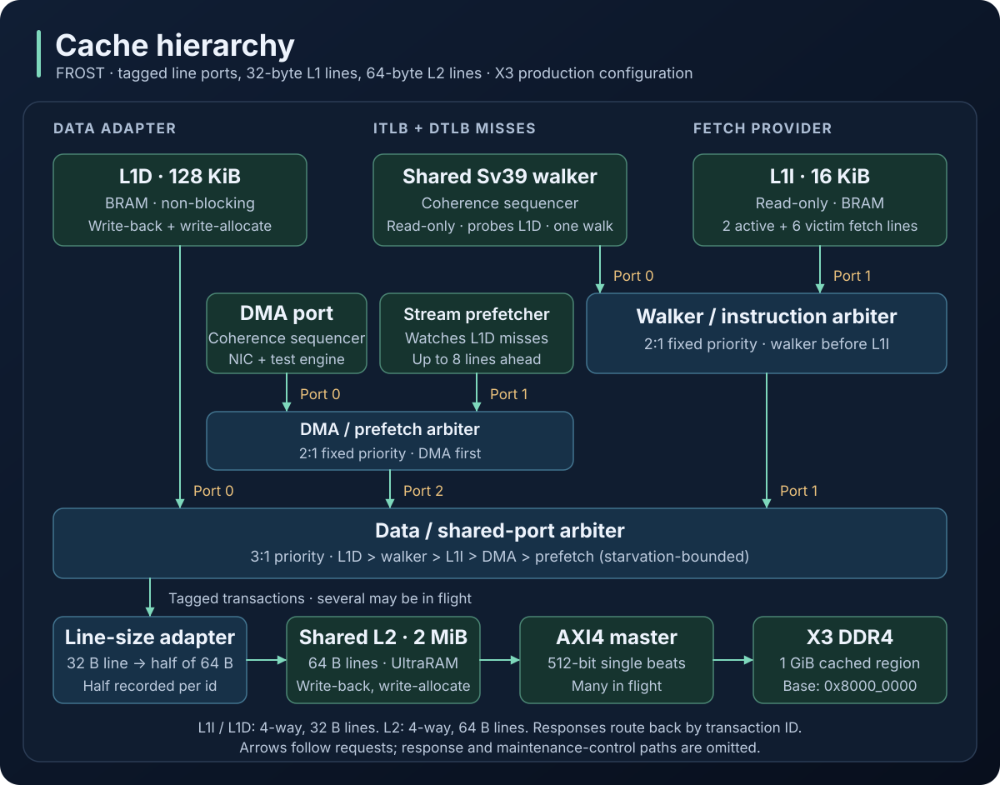

# Cache library

The CPU cache hierarchy has a private S/M L1D and L1I above a shared L2
home. The home orders acquisitions by sector, probes the L1D, merges dirty
replies through L2 and orders DMA against CPU accesses. Page-table walks
use the same home. FENCE.I writes private dirty data to L2 before
invalidating the instruction cache and fetch buffers.

The library also contains a generic nonblocking line cache, line arbiters,
size adapters, an AXI bridge and a behavioral memory model. Component
benches compose these modules independently of the CPU hierarchy.

| File | Role |
|------|------|
| `frost_cache.sv` | Generic line cache, used by the CPU L1I and the component hierarchy benches |
| `frost_hart_cache.sv` | One hart's private caches: the L1D and the L1I, the walker port's coherence sequencer, the probe injection register that the walker and DMA probes share into the L1D, and `fence.i` sequencing |
| `frost_cluster_cache.sv` | The shared level: the L1D, walker, L1I, and DMA ports and the stream prefetcher over the arbiter tree, the DMA coherence sequencer, the line-size adapter, and the L2 |
| `frost_cache_hierarchy.sv` | Component hierarchy for the line-cache unit benches |
| `line_size_adapter.sv` | Places each L1-line request in its sector of a wider L2 line and returns that sector of the response; an outstanding-transaction table holds each request's sector by id |
| `line_port_arbiter.sv` | N:1 tagged arbiter: fixed priority by port index, optional starvation bound, port index prefixed to ids |
| `dma_coherence_sequencer.sv` | Takes each DMA request through the L1D, and each DMA write through the load queue as well, before it reaches the L2 |
| `walker_coherence_sequencer.sv` | Probes the L1D before each page-table walk read reaches the L2; one read in flight |
| `l2_stream_prefetcher.sv` | Watches the L1D's misses and reads the lines ahead of ascending streams into the L2, never past the page of the last miss |
| `line_port_axi_bridge.sv` | Line port to single-beat AXI4 master; line ids become AXI ids, and each response carries the error bit of its RRESP or BRESP. The NIC's DMA master is one |
| `axi_behavioral_memory.sv` | Simulation-only DDR model: concurrent transactions, latency and jitter settings, optional out-of-order completion, and injected error responses |
| `cache_perf_pkg.sv` | Per-cache performance events: access, hit, miss, and writeback pulses, hit-under-miss, the outstanding-miss count, and two stall classes; and the L2's write costs: write misses that fetch their line, and writes that wait for a read of their line |
| `*_test_harness.sv` | cocotb tops: hierarchy + bridge + memory (with a bench-paced hold on the bridge), and arbiter + bridge + memory |

## Line protocol

In the line-port hierarchy, each port between the CPU-side adapters and the
AXI bridge carries one line per transaction with a transaction id. Lines are
32 bytes from the CPU-side adapters down to the line-size adapter and
64 bytes from there to
the bridge (`LINE_BYTES` below):

```
request:  valid  ready  write  addr[ADDR_WIDTH]  wdata[8*LINE_BYTES]  wstrb[LINE_BYTES]  id[ID_BITS]  maintenance
response: valid  id[ID_BITS]  rdata[8*LINE_BYTES]
```

- A request fires on a cycle with `req_valid && req_ready`, and the slave
  captures the payload then. Slaves act only on the fire, so a master may
  change or withdraw a request that has not fired. `addr` is a full byte
  address, used line-aligned.
- A slave's ready may depend on the presented request. The bridge, for
  example, accepts a read while a write's channels are still busy.
- `resp_valid` is a one-cycle pulse at least one cycle after the fire,
  carrying the request's id. `rdata` is the line for a read and don't-care
  for a write; a write's response is its completion acknowledgement.
- There is no response backpressure. A master issues only what it can sink,
  so every response has somewhere to go.
- A master may have any number of requests in flight, each with an id unique
  among its own in-flight requests. A slave may respond in any order.
- A cache applies requests to the same line in acceptance order: a write
  accepted before a read of the line is visible to the read, and a read
  accepted before a write never sees it. Each cache is the ordering point for
  its level and never relies on the level below to order a read against a
  write. The AXI bridge gives no such order (it can issue a read while an
  earlier write still waits), so same-line ordering is the hierarchy's job.
- Writes carry byte strobes. A write that sets every strobe of the cache's
  line allocates without fetching it. In the hierarchy no write does: an
  L1D eviction covers half an L2 line, so an L2 that lacks the line fetches
  it and merges the written half (see The L2 line size). Such a write would
  install even while a probe withholds the line's fills (see Probes), so a
  cache with `NUM_PROBE > 0` must not receive one on its upstream port. In
  the hierarchy that is the L1D, whose writes come from `cached_tier_adapter`
  and cover at most one 8-byte beat.
- `maintenance` exists on cache and arbiter ports, not on the hierarchy's
  upstream ports or the bridge. It marks `fence.i` writeback traffic, which
  lower levels leave out of every performance event. It never changes how a
  request is handled.

Masters do use this freedom: the arbiters re-select among their ports every
cycle, and the walker withdraws a read when its walk is discarded. A new slave
must take no action on a request until it fires.

## Coherent endpoint library

`coherence.f` supplies the channel endpoints and their programmable harness.
`cache.f` supplies the coherent controllers and line-cache components.
The CPU filelists include their ownership and issue-control dependencies.
The endpoints provide transport and ownership bookkeeping for the home
and hart controllers.

`coherence_pkg` defines opcodes, request identity, and home identity ranges.
`FROST_COHERENCE_TYPES(P)` in `coherence_types.svh` declares packed payloads
with physical address width P, from 32 through 56 bits. Fields appear in the
following order, most significant first. Each channel also has one-bit valid
and ready signals. A transfer occurs when both are asserted. Senders hold valid
and every payload bit during a stall. Addresses name aligned 32-byte sectors.

| Channel | Direction | Packed fields and widths | Payload bits |
| --- | --- | --- | --- |
| D | Requester to home | opcode 4, q 9, addr P, offset 5, size 3, mask 32, aq 1, rl 1, maintenance 1, wdata 256 | P + 312 |
| P | Home to hart | opcode 2, tid 6, epoch 1, addr P, requester 2, reason 2, check_q 9, offset 5, size 3 | P + 30 |
| R | Hart to home | opcode 2, tid 6, epoch 1, hart 1, addr P, state 2, clear 1, data_valid 1, data 256, absorbed 1, put_id 1, put_epoch 1, sc_valid 1, error 1 | P + 275 |
| W | Hart to home | hart 1, put_id 1, epoch 1, addr P, data 256, maintenance 1 | P + 260 |
| WA | Home to hart | hart 1, put_id 1, epoch 1, addr P, absorbed 1, tid 6, error 1 | P + 11 |
| G | Home to requester | opcode 3, q 9, tid 6, addr P, data 256, error 1 | P + 275 |
| C | Requester to home | q 9, tid 6, addr P, status 2, write_done 1 | P + 18 |
| U | Home to requester | q 9, tid 6, addr P | P + 15 |

Request identity q contains src 2, port_class 2, id 4, and epoch 1. Sources
0 and 1 name harts, 2 names DMA, and 3 names prefetch. Classes 0, 1, 2, and 3
name data, instruction fetch, page-table walk, and agent traffic. Hart data
IDs are 0 through 7, fetch IDs are 0 and 1, and the walk ID is 0. DMA IDs
are opaque four-bit values; prefetch IDs are 0 through 3. Admission limits
are four DMA requests and four prefetch requests. Admission arbitration is
external to the endpoint slots.

Home tid is six bits. For H harts, `completion_count(H)` is `11*H+8`.
`fill_base(H)` equals this count, `put_base(H,F)` adds F fill controls, and
`home_count(H,F)` adds two PutM controls per hart. H is 1 or 2. Home identities
must fit 64 values. Elaboration rejects invalid geometry and identity
parameters, including values that would truncate to another identity. A completion endpoint's TID is in the completion range;
fill and PutM controls have separate lifetimes. The epoch denotes cluster
reset. Every endpoint resets together, and its epoch input is stable during
operation. No coherent packet may survive reset. External response debt must
be drained or discarded before identities are reused.

| Encoding | Values |
| --- | --- |
| D opcode | 0 GetS, 1 GetM, 2 LoadReserved, 3 Atomic, 4 StoreConditional, 5 ReadOnceIF, 6 ReadOncePTW, 7 DMARead, 8 DMAWrite, 9 Prefetch |
| P opcode | 0 ProbeRead, 1 ProbeInvalidate, 2 CheckSC |
| R opcode | 0 ProbeAck, 1 ProbeData, 2 CheckAck |
| G opcode | 0 GrantS, 1 GrantE, 2 GrantM, 3 GrantData, 4 GrantAck, 5 GrantFail |
| C status | 0 Consumed, 1 Killed, 2 Error |
| MESI state | 0 Invalid, 1 Exclusive, 2 Shared, 3 Modified |
| Probe reason | 0 Read, 1 Write, 2 Replace, 3 Check |

Unlisted values are reserved. W, WA, C, and U implicitly mean PutM, PutAck,
Done, and Release. Size is log2 bytes. Offset and mask select bytes within a
sector. Hart write operands stay local; DMA writes use D.wdata and D.mask.
ProbeData and data-bearing grants carry a complete sector. Error overrides
permission installation. GrantFail grants no permission. These encodings
describe messages; the endpoint library does not implement MESI transitions.

`coherence_request_endpoint` reserves one request identity, a grant register,
and completion storage at local request acceptance. SOURCE, PORT_CLASS, and
SLOT select that identity. Separate instances provide independent D, IF, and
PTW credits. The local caller reserves installation and dirty-victim storage
before presenting a request. The endpoint holds D through acceptance and
captures a matching G by q and address. The local grant consumer then sends
Done. The endpoint keeps its identity through C and the matching U, including
killed reads. GetM, Atomic, and StoreConditional reject killed completion and
require write_done for a successful operation that grants permission.

`coherence_home_endpoint` reserves one TID at D acceptance. Its programmable
service sees `o_work` and supplies `i_result`, a complete G payload held until
`o_result_ready`. That transfer is the G transfer. The service reserves the
result source before admitting D. The completion record stores metadata;
Grant data stays in the service's reserved source until the requester's grant
register captures it. The dispatcher prevents duplicate live q values across
records. A record accepts C only after G and emits U only after C and every
registered absorbed-PutAck dependency. It becomes available on U consumption.
The caller owns the line lock and destination pin through that edge.
Completion identity and address comparisons use parallel three-bit groups.
Hart completion payloads select with local endpoint phase indications.
Channel valid signals apply reset qualification. Outside reset, each phase
indication equals its channel-valid signal. The local `o_c_selected` output
supplies this indication to the hart payload multiplexer.

The home service registers an absorbed R through `i_absorb` after preserving
its dirty image in a reserved sink. This port records cancellation metadata;
it does not store R.data. `i_cancel_valid` denotes the successful consumption
of an absorbed WA. It is an event, with the WA payload on `i_cancel`.
Matching includes hart, put_id, epoch, address, and TID. The record remembers cancellation before or on the absorption
notification edge. The service registers all absorptions before or on the G
transfer edge. Repeated absorption of one slot
within a completion is rejected. A failed WA leaves its dependency pending.

`coherence_put_endpoint` freezes one full sector until WA. HART and SLOT
select one of two slots per hart. An ordinary W transfer wins a simultaneous
absorption claim. An absorbed slot keeps W presented, and the home must mask
ordinary selection until the absorbed WA handshake cancels it. WA ready
certifies removal of that exact slot on the edge. `o_cancel_valid` reports
successful cancellation; another slot may keep the shared W port valid.
Ordinary WA is accepted only after W. Error WA preserves the frozen bytes
and asserts fatal until reset. The home holds an ordinary PutM's line lock
through successful WA consumption.

Error C and every completion of an error grant require `i_error_disposed` at
both endpoints, including killed reads. The service asserts it
only for an error whose ownership is safely disposed. Dirty data and failed
retired stores require fatal handling with ownership held through cluster
reset. Error grants cannot complete as Consumed. A killed read can discard
its grant without installing permission.

`coherence_channel` is a one-entry registered queue with no fall-through or
simultaneous refill. Separate instances hold P and R independently of demand
and PutM slots. Probe service, grant production, completion delivery, and
release delivery require independent service resources. Debug halt and WFI
must not stop those resources in an integration.

## Coherent one-hart cache path

`coherent_hart_cache` contains the L1D, read-only L1I, instruction and walker
bridges, and maintenance arbitration. `coherence_home` contains the shared
L2 controller and `coherence_home_array`, whose tag, data-read and masked-update
ports have independent service. The L1D's `coherence_array` serializes its
lookup, read and update operations in block RAM. The final tag-read edge
selects the private way and starts any required data read. Replacement state
uses the tag request's matching PLRU response.
The L1D uses 32-byte sectors; the L2 supports 32-byte or 64-byte lines.

The L1D has I, S and M states. Reads use S or M. A store hit in M writes its
bytes before completing. An S/I store reserves one committed pending record
and a dirty-eviction slot before acquiring M. The pending record owns the
address, bytes and mask after the SQ completion. It blocks local accesses to
its sector and yields probes while unrelated reads proceed. SQ launch readiness reserves the next cycle's registered write even when
line maintenance starts on that edge. There are eight
unmerged CPU read slots, two frozen PutM slots and one acquisition endpoint.
Read status uses per-slot masks for allocation, response transfer, lookup
results and grant completion. Completion and miss sets dominate allocation
clears. Allocation sets dominate response clears of valid bits. A failed
grant supplies the selected read's error bit. Status outcomes are computed
with and without allocation. The allocation pulse selects the outcome.

An L1D grant belongs to a live request endpoint. SC acceptance requires that
endpoint to be idle, so grant processing and SC acceptance are mutually
exclusive. Probe capture and service own local arbitration through R
acceptance. Invalidation admission starts on P capture and keeps the captured
address until the CPU accepts admission. Ready grants, writes and maintenance request one local selection
edge after R acceptance. An eligible read requests a turn after four completed
probe replies. Grants and writes take priority within that turn. A selected
local operation completes its bounded array service before P is accepted. Waiting for an operand, permission or retirement does not hold
the probe port. A withdrawn local offer releases its turn after one edge.
Read-slot payload writes pass through a one-record buffer. The buffer
captures the payload and a slot mask each cycle. The mask identifies the
allocated slot and is zero without an allocation. It qualifies forwarding
and writes to the slot storage. The forwarding mux
makes each allocation visible on the allocation edge. Each slot keeps its
allocated payload until reset or another allocation to that slot.
Allocation marks an empty slot valid. Read eligibility compares each physical slot with pending, atomic and frozen
writeback sectors. The comparisons use the stored slot addresses and the
buffered allocation's address, and the slot mask selects between their
results. Circular priority selects a qualified slot and its address.
There are no E grants, silent upgrades, sharer hints or stream prefetches.
The L1D has eight read slots. The home has four fills and `L2_NUM_WB` victim
write slots. `L1D_NUM_MSHR`, `L2_NUM_MSHR`, `L2_NUM_WAITERS` and the prefetch
parameters have no effect on the CPU hierarchy.

L1D performance events count the first permission lookup of each CPU read
or ordinary store. Cached SC selection counts as a permission miss. A store
to S and an AMO require permission and count as misses. Repeated lookups,
probes and maintenance do not add demand events. Outstanding misses include
unresolved read slots, the pending store and the selected SC. L2 events
count shared demand lookups and non-maintenance PutM lookups. Its fill count
is at most four. A DMA write miss contributes a write-fill event; probe data
merges do not contribute another demand. Events are registered at their
source and use the cache-counter ABI.

The hart uses source 0 and classes 0, 1 and 2 for data, instruction and walker
requests. Each class has one request identity. Source 2 and class 3 identify
DMA, whose four-bit ingress ID occupies q.id. `coherence_dma_ingress` has
four admission credits and holds each opaque ID through external response
delivery. It presents requests in acceptance order without waiting for earlier
grants or releases. Each slot independently owns its request, grant, completion,
release and external response. G matches the full q and address; U also matches
the granted tid. A fair arbiter captures C metadata from an accepted G
or a queued completion and holds its presentation. Each accepted U
produces its external response on the following cycle. A slot and its opaque ID return only at the external response edge.
Different sectors can complete out of order. The AXI bridge buffers read lines
by ID and presents AXI read beats and write responses in burst order.
Channel arbiters capture the payload with the selected input and hold both
through a stalled presentation.
The home's probe, tag, update, result and PutAck arbiters use their captured
selection for validity. Each selected source holds its offer through acceptance.
Fatal state suppresses probe validity, and the L1D applies reset to an
offered probe. Reset and fatal state suppress PutAck validity and further array
requests. Internal home and engine state changes are qualified by the stop
condition alone, because reset clears every register they update.
Read arbitration uses pending read offers. Home stop clears its
unaccepted selection. Accepted reads keep their tokens through physical
completion. A local fatal transition cancels an unaccepted read.

The home admits nineteen requests with distinct identities. Eight engines
share their image storage with the result credits. An engine hands its image
to completion ownership before G. An idle grant register captures an accepted
result directly when no older result awaits selection. The grant register
presents G while it holds a grant. G acceptance returns that image credit;
the identity and physical way pin last through U. Each request waits for U
from earlier requests to the same 32-byte sector.

`coherence_home_array` has separate tag-decision, data-read and masked-update
ports. Each request carries a response token. Replacement state changes when
the consumer claims a tag decision. An available miss response selects an
unpinned way. Way claims enter through the tag response port. Put and writeback address
hazards are checked at response acceptance. Tag updates exclude an unresolved lookup
of the same physical packed row. A pending tag update blocks further lookups
to that row until the update is accepted. Data hazards cover the read sample and the
write input registers through completion. Contending reads and writes alternate
service while prior operations drain. Masked updates preserve sibling sectors.

Four fill controls own memory-read IDs 0 through 3. Each fill has a primary
request and two read waiter seats. Parked requests release their engine and
image credit. A request waiting for a way or resource retries from completion
metadata. Returned fills wake their waiters after installation. Waiters reenter
array and probe service in sector order and sample the current resident bytes.
A successful fill's way pin lasts until its final waiter takes a completion
pin. A failed fill transfers its error to completion metadata and releases
its control before the waiters dispatch in sector order.

Fill waiter ranks are independent of the available-seat count. A balanced
prefix network counts up to three eligible entries before each candidate. Each fill
stores its occupied seat count beside the seat mask. Allocation, joining
readers, handoff and error cleanup update both on the same edge. A joining
engine uses one seat before the queued waiters. Ready work precedes other
eligible work. Both classes compute their circular priorities independently
before selecting an encoded winner. Work selection uses registered parking
state. A selection captured with a simultaneous fill park is canceled before
allocating an engine or image credit. The tag decision carries its captured
query address through conflict and replacement checks. Engine address pins
exclude valid victim lines. An invalid way's stored tag does not create an
address conflict; physical way pins and fill claims govern its reuse.

Two ordinary PutM controls have frozen payload storage and independent array
service. Round-robin arbitration rotates tag decisions, row reads, masked
updates, probes, acknowledgements and results. Resident data reads overlap
probes. Dirty probe bytes override the resident snapshot regardless of arrival
order; DMA byte enables apply after that merge. The final service edge
combines every completed input before the masked update or result becomes
eligible. Error replies preserve dirty ownership. Probe replies have
separate ownership from CPU reads, pending stores and PutM presentation.
A pending probe reply prevents local grant selection until R acceptance.
Grant application requires the private request endpoint to accept the grant.
A ProbeRead of M merges dirty bytes and leaves S. ProbeInvalidate leaves I
after the CPU cut. CheckSC returns the selected reservation result.
An ordinary probe starts its tag request on P capture when the array is ready.
Its reply forms on the edge that applies its state update, or on the lookup
edge when no state changes, once the required cut is done. A state-only array
update needs no data-write wait. A held R preserves its payload and prevents
another P capture.
CheckSC samples the reservation after capture.
Probe lookups read private data only for an M hit. A clean read probe leaves
the tag and bytes untouched. A downgrade or invalidation updates the tag
without writing the data row.

Every M sector has a resident L2 merge destination. Clean S and L0 copies
may outlive an L2 replacement. Replacement recalls every victim sector
without a directory hint, merges dirty replies, and freezes the complete
victim image before reusing its row. A valid victim reserves one of two
writeback slots before its first recall. Detached writes use memory IDs 16
and 17. The physical address stays locked until
a successful memory B response. A failed fill cannot expose the detached
victim tag. Grants pin their destination through C and U. An absorbed PutM
keeps its exact slot and epoch until WA cancellation. A completion with no
pending cancellations becomes eligible for U on the following cycle. A fair
arbiter holds each U presentation through acceptance. An ordinary PutM
owns its control through WA. DMA reads collect dirty private data; DMA
writes merge only their selected bytes after invalidation.
An L2-resident DMA read with no dirty probe data returns the resident image
without a data-array write. Fills and dirty replies reach the array before
the home grants the read.
A resident DMA write reads the L2 tag and writes its byte enables without
reading the data array. A dirty probe supplies the complete private sector
before those byte enables apply. The update preserves bytes outside its mask
and every byte in the sibling sector. A miss reads the victim and fills the
requested row before applying the write. GrantAck has zero data.

The home arbitrates held probe packets from engines and fill controls.
Reset and fatal status qualify probe service. The L1D computes incoming invalidate
eligibility from its phase, probe occupancy, reply occupancy, opcode and fatal
status. Probe validity and reset qualify that eligibility before it combines
with the resident invalidation hold.

The CPU cut stops local load launches at invalidation-probe capture. No read merging
crosses the cut. The capture address marks matching response owners before
that edge, preventing an L0 fill or LR reservation from a crossing response.
An unrelated LR keeps its reservation eligibility.
Invalidation covers L1D, L0, live read slots, reservations
and returned-load observations held until retirement. Delayed invalidated
LR responses cannot establish a reservation, and stale responses cannot
refill L0. Loads blocked by a pending store or selected atomic are parked so
that unrelated rows can issue. Cut admission and replay marking run in
parallel with the probe's array lookup and state update. The probe reply
waits for both operations. The global issue gate ends after replay marking
is effective; the matching-sector gate lasts through reply acceptance.

The atomic guard computes active and retired state for permitted and blocked
arming. Candidate validity and the entry veto select between those results.
The atomic guard captures the candidate tag while idle and holds it while
active. Only an active context qualifies the tag.

Cached SC and AMO requests acquire the home lock even on an M hit. The CPU
arms a tagged ROB-head context before D presentation. The active, unretired
context identifies a valid ROB head. Interrupt and debug
entry cannot cancel that context. A fault in the selected instruction
releases the context when no home transaction is live. SC
checks the reservation after home resource entitlement; a passing CheckSC
uses a self-ProbeRead to collect dirty data without cancelling its own
reservation. A granted SC asserts pending-write ownership while its result
waits for retirement. An interrupt or debug drain cannot stall the protected
owner's retirement. A completed single step prevents the following atomic
from acquiring ownership. The SQ writes only after the owner's retirement.
The SC bridge holds the home lock and same-sector interlock through the tagged SQ write.
AMO holds them through its read/compute/write sequence. C reports the actual
write. U releases the home ownership, and precise instruction ownership also waits for retirement.
Clean faults dispose C/U before precise exception entry. Dirty errors hold
ownership and raise the cluster fatal indication until reset.

A walker read first cleans its L1D sector through PutM, then uses ReadOnce.PTW.
Instruction refills use ReadOnce.IF. FENCE.I drains older writes, cleans the
whole L1D through PutM, invalidates L1I and resets the fetch generation.
Maintenance yields to probes and shares local array service fairly with
reads. FENCE, Device publication and serializer drains include pending
committed stores and the selected SC write. They do not require all dirty L2
bytes to reach external memory.

The unit benches `coherence_home_completions`, `coherence_home`, `coherence_home_equal`, `coherence_cluster`
and `coherent_cut` cover controller ownership, inclusion, cuts, atomics and
probe service. The whole-SoC program configurations use this hierarchy.
G and U route by their message source identity. Fair C arbiters select the
hart and DMA inputs and the hart's data, instruction and walker inputs. Each
arbiter holds its selection during backpressure and acknowledges only that input.
Every C source, including each DMA ingress slot, holds its offer until
acceptance, so these arbiters present their captured selection as C validity.

Formal targets `coherence_home_completions`, `coherence_control`, `coherence_array`,
`coherence_home`, `coherence_l1d` and `coherent_cpu` check endpoint service,
representative byte values, bounded controller transitions and CPU ownership.
Detached victim validity, address and a watched byte are checked by induction
through B. Cover tasks reach allocation, a delayed B, a blocked refetch,
successful disposal and a failed B with preserved dirty ownership.
The controller bounds assume legal channel peers, cut admission within four
cycles and invalidation acknowledgement within five cycles. They do not bound
external memory response latency.

## The line cache

The following sections describe the generic line-cache components.
`frost_cache_hierarchy` connects three `frost_cache` instances for unit
benches. Their default sizes and storage are:

| Instance | Size | Line | Ways x sets | Tags | Data | Miss slots | Waiter seats per miss slot | Writeback slots | Probe slots |
|----------|------|------|-------------|------|------|------------|----------------------------|-----------------|-------------|
| L1D | 128 KiB | 32 B | 4 x 1024 | Block RAM per way, 1-cycle read | Block RAM, a bank per way | 4 | 1 | 2 | 4 |
| L1I | 16 KiB | 32 B | 4 x 128 | Block RAM per way, 1-cycle read | Block RAM, a bank per way | 2 | 1 | 2 (unused) | 0 |
| L2 | 2 MiB | 64 B | 4 x 8192 | UltraRAM, a set's four ways in one 72-bit row, 3-cycle read | UltraRAM | 4 | 2 | 2 | 0 |

The ways are the hierarchy's `L1D_WAYS`, `L1I_WAYS`, and `L2_WAYS`
parameters. `L1D_NUM_MSHR` sets its L1D miss slots. `L2_NUM_MSHR`,
`L2_NUM_WAITERS`, and `L2_NUM_WB` set its L2 capacities.
The downstream IDs are `L2_DOWN_ID_BITS` wide. The default width of 5
holds up to 16 slots of each type.

### Sets and ways

The address bits above the line offset select a set, and a line may sit in
any of the set's `WAYS` ways (a power of 2; 1 is direct-mapped, which the
benches also run). Each way has a tag entry `{valid, dirty, tag}`, and a
request reads every way of its set at once: one block RAM per way in the
L1s, and in the L2 one UltraRAM row per set holding its four entries. The
L1s' data arrays have a bank per way, and the tag decision reads its set's
row in every bank, as a direct-mapped cache reads its one row. The block
RAMs feed a way multiplexer, and a fabric register after it holds the hit
way's line, or the victim's, as the read latency's last cycle. A read hit
answers three cycles after its request fires when nothing holds it, as the
direct-mapped L1s did. The L2's data array holds one line per row,
addressed `{way, set}`, and is read one stage after the tag compare, from
the way it picked, which adds one cycle to its longer lookup.

Each set keeps a tree pseudo-LRU state, one bit per node of a binary tree
over the ways (3 bits for four ways), in a small array read with the tags.
Hits and allocations point the bits on their way's path away from it;
probes, merges, and waiters leave the state alone. The L1D uses bimodal
insertion (`BIMODAL_INSERT`): an allocation updates the state only one time
in 32, chosen by a free-running LFSR, so a line that is filled and not hit
again stays its set's next victim. A cyclic working set somewhat larger than
the L1D then keeps part of itself resident, where updating on every fill
would evict each line just before its next use. A miss slot owns its way
from its allocation until it frees: the way's tag stays invalid while the
slot fetches, and the fill installs there. A miss replaces the lowest
invalid way that no pending miss owns, else the pseudo-LRU way among the
ways no pending miss owns: the walk down the tree turns away from a subtree
whose ways are all owned. When every way of a set is owned, a miss in that
set waits. In a 4-way set, the next five accesses to the set after an
installed line's last access evict it, whatever the set holds and has in
flight, if they reach the cache, are to five different other lines that no
miss is already fetching, and nothing invalidates a line of the set
meanwhile. In the L1D each of those lines must also be hit once it is
installed, since its fill alone usually leaves the state alone
(`sw/lib/include/cache_evict.h` reads a line and then hits it). A line whose
own fill is still pending cannot be evicted until the fill completes. The
test programs that force evictions rely on this.

### Requests and misses

A request goes straight to the tag stage, or waits in a one-entry skid
until the tag stage can take it, and reads its set's tags. It is decided
when the tags return (`TAG_READ_LATENCY` cycles), and its side effects land
in a write stage the next cycle. The L1s read the data array at the
decision, the L2 in the write stage.

- A read hit returns data with the data array's output. The L1s' one-cycle
  tags stream one hit per cycle; the L2's delayed tags decide one request at
  a time.
- A write hit writes the strobed bytes and marks the line dirty.
- A miss takes one of `NUM_MSHR` miss-status slots and a victim way, and the
  slots fetch from the level below concurrently. A dirty victim moves into
  one of `NUM_WB` writeback slots and drains independently. With one-cycle
  tags (the L1s) every miss waits for a free writeback slot, whatever its
  victim, so the decision does not wait on the compare and the victim
  choice; with delayed tags (the L2) only a dirty victim does.
- A write miss merges its bytes into the fill: the fill supplies only the
  bytes no store has written, including a store that merges in the same
  cycle the fill arrives.
- A write to a line whose write-allocate slot is pending merges into that
  slot, and a read of a line with a pending miss takes one of the slot's
  `NUM_WAITERS` waiter seats: one in the L1s, two in the L2 beside the
  stream prefetcher. Anything else aimed at a line in transition waits and
  reads its tags again before deciding, and so does a miss whose set has
  every way owned by pending misses.

Requests to other lines of a set do not wait for a pending miss in it:
they hit the other ways, or miss into a way no pending miss owns. A line is
in at most one way, since only a miss allocates it, and a miss finds no way
holding the line and no slot fetching it. A request waits in the skid while
the tag or write stage holds its set, so it reads the tags and replacement
state after their writes.

Writes, hits and misses alike, are acknowledged once the cache has ordered
them, so a store miss does not wait for its fill. Hits proceed past pending
misses. Downstream ids are `{type, slot}`: type 0 is the fill of a miss slot,
type 1 a writeback slot.

### Writebacks

A line that still sits in a writeback slot is not fetched or installed again
until that writeback is acknowledged:

- A fill of the line waits before fetching, so the cache never relies on the
  level below to order a read against a write.
- A whole-line write that allocates without a fetch waits before
  installing.
- A store to a copy that a probe left valid and clean waits before dirtying
  it again.

No line therefore ever has two writebacks in flight. The level below, or an
AXI fabric, could apply two writebacks of one line in either order and leave
the older data in memory.

These waits need writebacks to make progress. The downstream request
register takes a pending fill before a pending writeback, because a stalled
load or store is waiting on the fill. Preference alone can starve a
writeback: if the level below accepts slowly, fills that complete and
reallocate between its acceptances keep a fill pending at every load of the
register. So a writeback that has lost `WbStarveLimit` (3) loads to fills
takes the next one, and the writeback slots take turns. A pending writeback
is loaded within 4 loads of the register, and any given slot within
`NUM_WB` times 4 (8 with two slots), however slowly the level below accepts.

The miss slots take turns too. The fill pick starts from the slot after the
last one it loaded, so a fill that can issue is loaded within `NUM_MSHR`
fill loads. A fixed order would let low slots that keep reallocating between
the level below's acceptances starve a fill in a high slot.

### Probes

The L1D (`NUM_PROBE > 0`) takes per-line coherence probes on its upstream
port: read-shaped requests flagged `probe`, of two kinds.

- PROBE_CLEAN writes a dirty copy back and leaves it valid and clean.
- PROBE_INVAL writes a dirty copy back and invalidates it.

A probe returns no data. Its response pulse is the acknowledgement, sent only
after the level below has acknowledged any writeback the probe caused, so the
requester can order its own access behind that writeback. Probes go through
the pipeline like any other request and compare every way of the line's
set, so they find the line wherever it sits: a probe aimed at a line in
transition waits, one aimed at a line in a writeback slot waits for that
writeback, and a probe never merges or takes a waiter seat. A probe that
hits waits for a free writeback slot, as an L1 miss does, and is
acknowledged from the write stage when its line is clean.

Each probe holds a probe slot from its decision until the requester releases
it, after the level below has ordered the requester's own access. While a
PROBE_INVAL slot is held, the cache issues no fill of that line. A miss that
follows the invalidation waits in its miss slot and fetches the line after
the release, instead of fetching the old data again. A whole-line write would
install without waiting for the release, and a walk's PROBE_CLEAN could then
write it back ahead of the DMA write, leaving a clean copy older than the
level below's; that is why a probed cache must never receive one (see Line
protocol). A fill of the line allocated before the probe's decision is never
withheld: the probe waits for it and invalidates what it installs.

Pending probe acknowledgements take the response port ahead of ordinary
acknowledgements and hold off new read hits, so a stream of hits cannot
starve them.

### Maintenance

`fence.i` uses two operations, each of which starts only once every slot and
pipeline stage is empty:

- Writeback-all reads each set's tags, writes its dirty ways back through
  the writeback slots one at a time, rereading the set after each, and
  marks them clean; the lines stay valid. `o_maint_busy` falls once those
  writebacks are acknowledged. The walk covers only the set span dirtied
  since the previous writeback-all.
- Invalidate-all reruns the reset sweep, which clears one set's tags and
  replacement state per cycle (128 cycles in the L1I). It discards dirty
  data, so only the read-only L1I uses it.

`frost_hart_cache` runs them in order: the L1D writes back first, then the
L1I invalidates, so an instruction fill racing the sequence cannot leave
pre-writeback data in the freshly invalidated L1I. The L2 needs no
maintenance: it sits below both L1s, so everything the L1D writes back is
visible to L1I fills.

A sequence answers only a request held since it started. A full flush can
take the request away mid-sequence (an interrupt taken while `fence.i`
waits); the sequence still runs to its end, since the sweeps cannot be
aborted, but it finishes without raising done. Stores can reach the L1D
after its writeback walk, so a request raised again gets a fresh sequence.

Maintenance and probes never overlap. Maintenance waits for the probe slots
to empty like any other in-flight work, and a probe waits for maintenance
like any other request, parked in the hierarchy's probe injection register.

Reset runs the sweep too, so every reset, including an image load, discards
stale lines instead of writing them back. `SIM_FAST_MAINT=1` (simulation
only) makes the sweep a one-cycle clear and makes writeback-all visit only
sets with dirty lines, with the same functional effect.

## Component hierarchy

The line-cache component hierarchy has two parts. `frost_hart_cache` holds one hart's private
caches: the L1D, the L1I, the walker port's coherence sequencer, and the
probe injection register in front of the L1D. `frost_cluster_cache` holds
the shared level, which puts the L1D's, the walker's, the L1I's, and the DMA
port's traffic and the stream prefetcher's reads over one arbiter tree into
the L2, through the line-size adapter. The L2 is the ordering point for all
traffic below the L1s and drives the AXI bridge. The parts connect through
the L1D's, the L1I's, and the walker sequencer's line ports and the DMA
sequencer's probes into the L1D. Requests and responses pass through the
arbiters and the adapter without a register stage, so the boundary between
the parts adds no cycle.
`frost_cache_hierarchy` composes the two parts for component benches.
The CPU hierarchy uses `coherent_hart_cache` and `coherence_home`.

[](../../../../docs/diagrams/cache-hierarchy.svg)

The diagram shows the line-cache component hierarchy. Arrows follow
requests; responses return by id prefix.

The arbiter tree is a 2:1 `line_port_arbiter` (walker over L1I) under a 3:1
one (L1D over that pair over DMA). With the stream prefetcher
(`L2_PREFETCH`), a second 2:1 arbiter (DMA over the prefetcher) takes the
DMA port's place under the top one. All are combinational pass-throughs, so
the tree acts as one fixed-priority arbiter ordered L1D, walker, L1I, DMA,
prefetcher. The order follows urgency: L1D misses stall committed work, a
walk unblocks a load that is stalling commit, fetch runs ahead through its
buffer, DMA drains a device's buffers, and a prefetch only reads ahead.

There is no grant lock. A request flows whenever the level below is ready,
so an L1I fill, a walk, an L1D transaction, and a DMA transaction can all be
in flight below the arbiters at once.

The top arbiter bounds starvation (`DMA_STARVATION_LIMIT`, 16 grants). A port
that has watched 16 grants go to other ports while presenting a request wins
over every port that is not starved. Another starved port may win first, so
a port waits at most 17 competing grants. The bound counts grants, not cycles,
so it holds however slowly the L2 accepts, and it gives the DMA port a
progress guarantee under a sustained stream of CPU-side misses.

Each arbiter prefixes its port index to the ids it forwards, so ids stay
unique across all upstream masters without a global plan. The tree yields a
prefix-free code in `UP_ID_BITS + 2` bits:

| Master | Id below the top arbiter | Local id bits (`UP_ID_BITS=4`) |
|--------|--------------------------|--------------------------------|
| L1D | `{2'b00, id}` | 4 |
| Walker | `{2'b01, 1'b0, id}` | 3 |
| L1I | `{2'b01, 1'b1, id}` | 3 |
| DMA port | `{2'b10, id}`; with the prefetcher `{2'b10, 1'b0, id}` | 4; with the prefetcher 3 |
| Prefetcher | `{2'b10, 1'b1, id}` | 3 |

The L2 sees those 6 bits. Its downstream requests carry `{type, slot}`
IDs, `L2_DOWN_ID_BITS` wide. With `UP_ID_BITS=4`, the L1D spends one
bit on the fill/writeback type and has 3 bits available for miss slots.
The L1I has 2 miss slots. The walker keeps one walk in flight and uses
ID 0. `axi_coherent_bridge` uses 3 bits of its IDs. The prefetcher's
3 local ID bits support up to eight outstanding reads; its default
limit is four reads.

The bridge drops any response whose id is not in flight. That is how a
transaction interrupted by an image-load CPU reset drains harmlessly on
hardware, where the DDR controller keeps running through the reset: its
stale response meets a cleared in-flight map. A request the bridge was still
presenting when the reset came stays presented until the controller accepts
it, as AXI requires of a master whose slave is not reset, so a write whose
address was accepted before its data never leaves an orphaned beat behind;
its response is then dropped the same way. A late response would pass for
the response to a new request with the same id, so the reset moves the
in-flight map into a second map of transactions still owed from before it,
which only their responses clear, and the bridge accepts no request until
that map is empty. An image load relies on those transactions completing
promptly in another way: nothing orders the JTAG loader's DDR writes after
the bridge's, so each write the bridge accepted before the reset must land
before the loader's first DDR write.

Production `cpu_top` uses `cpu_memory_fabric` and `cpu_axi_master` to combine
cache lines with narrow uncached data and instruction traffic.
`line_port_axi_bridge` carries the NIC's DMA requests over AXI4 and connects
the component tests' hierarchies to their memory models. ID allocation
and AXI attributes are documented in the [CPU interface](../../cpu_top/README.md).

With `ENABLE_RESPONSE_ERRORS=1`, SLVERR/DECERR on a read fill returns an error
to every waiter and never installs the line. LQ, instruction fetch and the
page-table walker translate that error into an architectural access fault.
Failed writebacks or write-allocated fills retain dirty ownership, latch a
fatal address and stop CPU retirement. They cannot be made precise after a
buffered store has retired. FROST's SoC also counts board DDR error responses
in `memory_error_unit`; `memerr_test` checks the read exception, ECC/APLIC
reporting and final fatal writeback stop. Coherent responses carry errors
through the home and DMA ingress to `axi_coherent_bridge`, which answers
SLVERR to the NIC or the DMA test engine. `ENABLE_RESPONSE_ERRORS`
defaults to 0 in the generic line-cache modules. The CPU enables response
errors on its instruction cache and propagates coherent data errors.

The behavioral DDR model accepts `+axi_rd_error_addr=<hex>` and
`+axi_wr_error_addr=<hex>` for region-relative failed lines. `line_port_axi_bridge`
also requires `+axi_error_check=0` when such errors are intentional.
`sw/apps/ecc_scrub_test` observes writebacks with the write form: evicting a
clean line writes nothing, and evicting a line rewritten with atomic no-ops, as
the Linux memory error driver scrubs, writes it once, which stops the CPU.

The interconnect's own reset is different. While it is in reset, AXI
requires every VALID low, so the bridge takes that reset as a second input
(`frost`'s `i_ddr_axi_rst_n`, which X3 drives from the SmartConnect's
CPU-side reset, the CPU clock's lock). It gates the held VALIDs off in the
cycle the reset arrives and drops those beats, so none is presented after the
interconnect restarts. The behavioral DDR model in simulation resets with
the CPU, so there the CPU reset serves as both.

Reset clears the model's outstanding transactions but preserves its memory
contents, including the initial `sw_ddr.mem` image and completed writes.
This also applies to the sparse storage selected by `FROST_WIDE_DDR_TEST`.
Only TestRIG (`FROST_RVFI_DII`) skips image loading and clears memory on reset,
so each instruction sequence starts with empty storage.

## The L2 line size

In the generic line-cache hierarchy, the L1s, walker and DMA port use
32-byte lines. The arbiters, both coherence sequencers and L1D probes
use the same line size. The L2 uses 64-byte lines, each holding two 32-byte lines as
its lower and upper halves, so every DDR transfer is one 512-bit beat, the
width of the X3 DDR4 controller's word. The controller runs ECC without a
data mask, so a write of less than a whole word makes it read the word,
merge, and write it back; the L2 writes back only whole lines.

In general `L2_LINE_BYTES` is a power-of-2 multiple of `L1_LINE_BYTES`, and
each L2 line holds that many L1 lines as sectors. With equal line sizes the
adapter below is left out. `frost` and `cpu_top` take `L2_LINE_BYTES`,
64 by default; at 32 the DDR AXI port is 256 bits wide. The X3 top sets 64,
one line per beat of its block design's 512-bit CPU port.

`line_size_adapter` sits between the top arbiter and the L2. Valid and ready
pass straight through, so a request is accepted by the adapter exactly when
the L2 takes it, and the coherence sequencers' arguments, which order DMA
writes and walks by that acceptance, hold as they do with equal lines. Ids
pass through too. The adapter aligns the address to the L2 line and maps
each request onto its sector in three separate parts: the data goes into
every sector, the strobes into the request's sector only, and the response
returns the request's sector of the line. An outstanding-transaction table
with one entry per id records each request's sector when it fires, and the
response, which carries the same id, reads it back. Responses return in any
order. The table needs no reset: an entry is written when its request fires,
and only that request's response reads it.

The adapter holds no request of its own, so it merges none: reads of one L2
line meet in the L2's miss slot, as below. A merge in the adapter would break
the acceptance order. For example, while an L1I read of one half of a line
misses, a DMA write to the other half is accepted and releases the L1D's
withheld read of that half; merged into the L1I read's fill, the L1D read
would return the line from before the write.

With several L1 lines in one, the L2 works as follows:

- Requests to any sector of an L2 line are applied in acceptance order, a
  stronger order than the L1s need.
- Reads of a missing line share one fill, whether they read one sector or
  two: the first takes the miss slot and each later one a waiter seat. A
  read past the seats waits in the decision stage until the fill installs.
- A write never covers a whole L2 line. One that misses, an L1D eviction of
  a line the L2 has lost or a DMA write to a line it lacks, fetches the line
  and merges its bytes into the fill. A write to another sector of the line
  merges into the same miss slot while that slot has no waiter.
- A write to a line whose miss slot is a read's, or holds a waiter, waits in
  the decision stage until the fill installs. The decision stage takes one
  request at a time, so all L2 traffic waits behind it for that fill.
- An eviction writes the whole line, with every strobe set, in one transfer.

The profiling counters measure both write costs
([counters 130–133](../../cpu_and_mem/cpu/cpu_ooo/perf/README.md)).
`frost_cache` exports them as a second event bundle, and the hierarchy
carries the L2's to the counters. A write fill is a write miss that takes a
miss slot to fetch its line: it counts when it allocates, and the slots that
write fills hold are summed each cycle. A write that merges into such a slot
does not count. A write that finds its line's slot fetching for a read, or
holding a read waiter, counts once when it starts to wait, and every cycle
until its next decision counts while the decision stage holds it, so a wait
adds the cycles from its first decision to the one that completes it. Like
every cache event, they leave out `fence.i` writebacks.

Reset clears the L2's 8,192 sets, one set per cycle on hardware.

DMA coherence works with either line size through the DMA port
(see The DMA port and coherence). A master that reaches DDR below the L2
sees neither cache level. The generic line-cache interface carries ordinary
reads and writes. The CPU's cached atomic operations use the home protocol
described above.

## The stream prefetcher

`l2_stream_prefetcher` reads ahead of ascending L1D miss streams into the L2.
`frost_cache_hierarchy` enables it with `L2_PREFETCH=1`. It watches the
L1D's read requests as the top arbiter takes them, which are its misses,
store misses included. A table of 4 streams holds the last L2 line each
stream missed on. A miss on the line after a stream's confirms the stream
and advances it, a miss on its own line leaves it, and any other miss
replaces a stream in rotation. For each confirmed stream the prefetcher
reads the lines after its last miss, up to `L2_PREFETCH_DISTANCE` (8) lines
ahead and never past the 4 KiB page of that miss, so it reads only memory
that a demand access in the same page showed to exist.

The reads are ordinary line reads on the prefetcher's side of the DMA port,
at most `L2_PREFETCH_INFLIGHT` outstanding (4 by default).
Their responses only
free the prefetcher's ids: the point is the L2 fill, which takes a way and
touches the set's replacement state like a demand fill. A demand read that
arrives while its line's prefetch is pending meets it in the L2's miss slot,
where the prefetch is the primary request. The L1D reads both halves of the
line, so the L2's slots have two waiter seats (`L2_NUM_WAITERS`); with one,
the second half would wait in the decision stage, and all L2 traffic behind
it, until the fill.

[`ddr_bench`](../../../../sw/apps/ddr_bench/) times memory-bound kernels on
cold DDR regions, among them four streams whose lines share one set of
each cache, with the L2's slot-full and conflict stall counts and its write
costs per kernel.

## The page-table walker port

The hardware page-table walker (`ptw.sv`) is the hierarchy's `wup` port,
between the L1D and the L1I in priority. With no grant lock, a ready walk
never waits for an L1I fill to complete. A walk is a chain of dependent
8-byte PTE reads, one per level, each a full-line read on this port; the
walker extracts its PTE from the line response the way
`cached_tier_adapter` extracts a beat. One walker serves both TLBs through a
requester mux in `cpu_ooo`, where the data side wins, and one walk is in
flight at a time. Walks only read: an access that needs a PTE's A or D bit
set takes a page fault (Svade), so there is no PTE write path. Walker reads
carry `maintenance = 0` and count as ordinary traffic.

Page tables live in cacheable DDR, and a page-table store sits dirty in the
L1D like any other store, while the walker reads below the L1D. Software also
publishes page tables without `sfence.vma`: Linux fills a new table, executes
`fence w,w`, stores the pointer to it, and uses the mapping before the
closing `sfence.vma`. A walker that read only the L2 could see the new
pointer (evicted from the L1D) together with the stale table below the L1D
that it points to. That is a translation that never existed, which the
architecture forbids: a walk may return any translation valid since the last
`sfence.vma`, but not a mixture.

`walker_coherence_sequencer` prevents this. Every walk read first sends a
PROBE_CLEAN to the L1D, so a dirty copy is written back and ordered at the
L2 ahead of the read, and stays valid and clean in the L1D. Stores still in
the store queue are not covered, and need not be. They drain to the
L1D in program order, so a walk that sees a later page-table store sees
every earlier one, and a walk that sees neither returns the old translation,
which is still permitted.

`sfence.vma` still runs the L1D writeback-all of the `fence.i` sequence, and
the ROB serializer's SFENCE window (`rob_serializer.sv`) holds both TLBs
invalid and keeps the walker from starting a walk or returning a result for
the whole sequence, so nothing translated under the old tables installs
meanwhile. Walks do not depend on that writeback.

The walker and DMA sequencers share one probe injection register into the
L1D. The walker takes priority for it: with one read in flight it presents at
most one probe per round trip, so it cannot starve the DMA entries. The L1D
has one more probe slot than the DMA sequencer can occupy, so one is always
free for the walker.

Progress: once accepted, a walk read completes on its own.

- The probe waits only on L1D transients that resolve through the L2 (a
  fill or writeback of the line already in flight, a writeback slot to free,
  or a request ahead of it in the tag stage waiting on one of those) and on
  its reserved probe slot.
- The acknowledgement waits only for the level below to acknowledge the
  dirty writeback.
- The issue waits only for the arbiter tree, where the higher-priority L1D
  traffic is finite while the CPU waits on the walk.
- The response is unconditional.

No step waits on the walker, the pipeline, commit, or the store queue, and
walks and cache maintenance cannot deadlock. A probe that arrives while
maintenance is pending waits in the injection register, outside the L1D
pipeline that maintenance drains. A probe that already holds a slot releases
it when its read is accepted, which never waits on maintenance, so a
writeback-all waiting for the probe slots to empty always gets them. A walk
discarded by `sfence.vma` or a `satp` write still consumes its response
(`ptw.sv`).

## The DMA port and coherence

The DMA port (`dma`) is the hierarchy's fourth upstream port and reaches the
top arbiter through `dma_coherence_sequencer`. The L1D is write-back and the
load queue keeps its own dword copies of loaded data, so a DMA agent that
simply joined the tree below the L1D would neither see the CPU's dirty data
nor invalidate the CPU's stale copies. The sequencer therefore takes every
DMA request through the L1D, and every DMA write through the load queue as
well, before the L2 orders it. It holds up to `NUM_DMA_LOCK` (3)
requests between acceptance and response, one per lock entry, and accepts a
new request only when an entry is free and no active entry holds the same
line.

A DMA write goes through five steps:

1. The load queue admits the line: no AMO or SC on it is between its read
   and its write, and the queue starts no AMO, LR, or SC on it until step 4.
2. A PROBE_INVAL writes a dirty L1D copy back and invalidates the line,
   whichever way of its set holds it (a line is in at most one way). From
   the probe's decision until step 4, the L1D issues no fill of the line: a
   miss that fetched before the write is ordered would bring the old line
   back.
3. The load queue drops its dword copies of the line, flags loads of it that
   have executed but not retired for replay, marks in-flight loads of it as
   not-to-fill and in-flight LRs as reservation-suppressed, and clears a
   matching reservation.
4. The write is presented downstream. Its acceptance by the L2 orders it,
   releases the L1D probe slot so that withheld fills fetch the new line,
   and pulses the release to the load queue. Acceptance is enough because
   the L2 applies same-line requests in acceptance order: a withheld fill
   reaches it behind the write.
5. The L2's completion becomes the DMA port's response.

A DMA read sends a PROBE_CLEAN, which writes a dirty copy back and leaves it
valid and clean, then presents the read. The probe slot is released when the
read is accepted, and the response carries the line as ordered behind any
dirty L1D data.

The sequencer guarantees coherence order, not wall-clock order. An
acknowledged write is visible to every CPU load that observes memory after
it. A load that observed memory before the write may still return the old
value afterwards; that is legal in coherence order, and the load queue's
replay of executed-but-unretired loads keeps program-order consequences
correct. Requests to different lines are not ordered with respect to each
other, so an agent orders dependent writes by waiting for responses. Requests
to the same line serialize in acceptance order, because the second waits for
the first's entry to retire.

Progress: a probe waits only on L1D transients that resolve through the L2
and DDR: a pending fill or writeback of its own line, a free writeback slot,
and requests ahead of it in the tag stage, which wait on the same kinds of
transients. A pending miss of another line of its set does not hold the
probe itself. The probe never withholds a fill of its line allocated before
its decision; such a fill may be withheld by an earlier probe of the line,
and then waits for that probe's release. A withheld fill waits only for the
release, which depends on the load queue and the L2 alone. Nothing below the sequencer
waits on the DMA port. The admit and invalidate handshakes hold a latched
request until the load queue answers, so the core may take several cycles
to answer.

## Verification

| Target family | Coverage |
| --- | --- |
| `frost_cache*` | Tagged data, instruction, and walker traffic, maintenance (also on the fast simulation path), out-of-order memory completion, and dirty-L1D walker coherence |
| `frost_cache_concurrency*` | Hits and misses under outstanding misses, merge and waiter paths, a miss waiting for a way of its set, writeback and fill progress, and `fence.i` |
| `frost_cache_dma*` | Coherent reads and writes, invalidations, ordering, and concurrent CPU and walker traffic |
| `frost_cache_l2_lines*` | 64-byte L2 lines: both halves of a line sharing one fill and a reader past the waiter seats waiting, write misses that fill and merge in either half, a writeback waiting behind its line's read fill, halves combining in one line, whole-line writebacks, DMA writes changing only their half, L2 ordering across halves, a refill waiting for its line's writeback, `fence.i` into lines the L2 lacks, reset with misses in flight, and every port's misses at once; every AXI transfer checked as one whole-line beat. The write-cost events count each write miss that fetches its line once, and no hit, merge, or read miss, and each write held behind a read of its line once, with the cycles from its first decision to the one that completes it, and no merge or waiting read |
| `*_equal_lines` | The data-integrity, concurrency, and DMA suites with 32-byte L2 lines, equal to the L1s', as a control; also DDR load and store, fetch, atomic, DMA, page-table-walk, and `fence.i` programs on the whole system with 32-byte L2 lines and a 256-bit DDR port |
| `*_16x4` | The L2-line, concurrency, and DMA suites with 16 L2 miss slots and 4 writeback slots |
| `frost_cache_l2_lines_waiters2` | The L2-line suite with two waiter seats per L2 miss slot |
| `*_prefetch` | The concurrency and DMA suites with eight L1D miss slots, eight L2 miss slots, two waiter seats per L2 miss slot, and eight prefetch requests |
| `*_ways1` | The data-integrity, concurrency, DMA, and L2-line suites with direct-mapped caches |
| `l2_stream_prefetcher*` | Stream confirmation, read distance, page bounds, response ID reuse, and four- and eight-request caps under excess demand |
| `line_port_arbiter*` | Arbitration and tagged responses |
| `line_port_axi_bridge` | The bridge across a CPU reset against a slave that keeps running: held beats, AW/W pairing, dropped stale responses, and a reused id held back until the stale response for it has arrived; and across the slave's own reset, which withdraws the held beats |
| `axi_behavioral_memory_*` | Boot-image loading and reset persistence for dense and wide sparse DDR, distinct high-address writes, and TestRIG's empty-memory reset contract |
| `fence_speed_slow`, `fence_speed_fast` | Maintenance latency; CLI-only |
| `dma_envelope_lock3` through `dma_envelope_lock8`, `dma_envelope_lock3_mem30`, `dma_envelope_lock3_big_l2` | DMA throughput and latency by lock count and scenario; CLI-only |
| `l2_slots_4x2`, `l2_slots_8x2`, `l2_slots_16x4` | L2 miss-slot use with every port missing at once, by slot count, with no read waiting more than 1,000 cycles; `l2_slots_8x2` and `l2_slots_16x4` CLI-only |

Run a target with `./scripts/frost.py cocotb <target>`; `--list-tests` prints
the exact names. The benches live in
[`verif/cocotb_tests/cache`](../../../../verif/cocotb_tests/cache/). The
full-system programs `dma_torture` and `ptw_coherence_test` check DMA and
walker coherence against the running CPU. Formal targets cover the bridge
(`line_port_axi_bridge`: AXI handshakes, also across a CPU reset, VALIDs low
through the AXI side's reset, id conservation, stale-response drops, no
request accepted while a response from before a reset is owed, and each
response's error bit), the
line-size adapter (`line_size_adapter`: strobes and data in the request's
sector, and each response returning the sector its request recorded), the
arbiter grant (`line_arbiter_grant`), the miss-slot byte merge
(`cache_mshr_payload`), and the way choice (`cache_way_choice`: an
allocation takes a way outside the tag stage's ownership mask, the
timing-factored decision equals its reference, a touched way is never the
next pseudo-LRU victim, and the restricted walk picks the pseudo-LRU way
whenever it is unowned); see the [formal guide](../../../../formal/README.md).
In simulation, assertions check that no two miss slots own one way and that
an allocation never takes a way a miss slot owns. In coverage builds,
[cover points](../../../../tests/README.md#cover-points) count corner cases
such as a read taking a miss slot's second waiter seat, a demand read
meeting a prefetch of its line, and a writeback taking its starvation turn.
They also count merges and waiter attachments on the fill-response edge,
fill installations that force a delayed tag lookup to retry, and failed
read fills with attached waiters.
